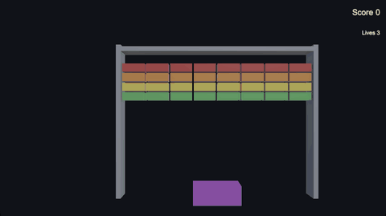
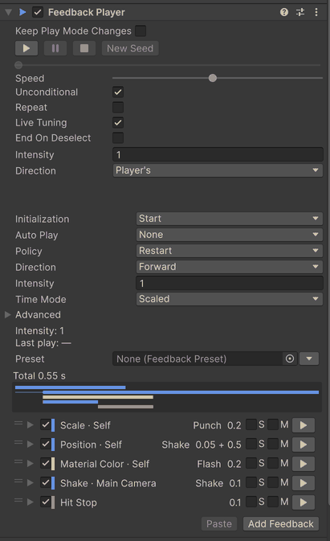

# xpTURN.Feedback

[English](README.md) | [한국어](README.ko-KR.md) | **日本語** | [简体中文](README.zh-CN.md)

> この文書は英語の [README](README.md) の翻訳です。内容が異なる場合は英語版を正とします。

<!-- english: ba1e8cb6028f -->



Unity 6 向けのゲームフィール・フィードバックです。ヒット・ジャンプ・ボタンの手応えを生む動き・フラッシュ・シェイク・一時停止を
作ります。Feedback Player はアイテムのリストを持ちます。多くはターゲット（値を書き込む先）とモーション（その値が時間とともに
どう動くか）の組で、残りはリストを形づくるアクションとステップです。PlayerLoop のスケジューラーひとつがすべてのプレイヤーを
再生します。シェイク・パンチ・フラッシュは元の値の上に書いて元に戻し、トゥイーンとセットは終わった位置に値を残します。一度
ウォームアップした後は再生ごとのアロケーションがなく、同じアイテムをエディットモードでも再生できるので、プレイモードに入らずに
調整できます。シーンにあらかじめ置いておくものはありません。

<!-- gen:snippet:readme-hit -->
```csharp
public class Enemy : MonoBehaviour
{
    [SerializeField] FeedbackPlayer onHit;
    [SerializeField] float maxHealth = 100f;

    public void TakeDamage(float damage)
        => onHit.Play(PlayArgs.Default.WithPosition(transform.position).WithIntensity(damage / maxHealth));
}
```
<!-- /gen:snippet:readme-hit -->

## 含まれるもの

- **ターゲット × モーション** — <!-- gen:count:targets -->141<!-- /gen:count:targets --> のターゲットが <!-- gen:count:motions -->11<!-- /gen:count:motions --> のモーションを <!-- gen:count:combinations -->361<!-- /gen:count:combinations --> 通りの組み合わせで受け取ります。
- **追加メニュー** — 検索・お気に入り・最近使った項目を備えた <!-- gen:count:leaves -->377<!-- /gen:count:leaves --> 項目。
- **エディットモードのプレビュー** — プレイヤーの ▶ を押すと Scene ビューと Game ビューで確認でき、止めると値が戻ります。
- **プリセット** — オブジェクトに置くか、プレイヤーからリンクするプリセットが <!-- gen:count:presets -->21<!-- /gen:count:presets --> 個。
- **バリデーターとデバッガー** — ワンクリックで修正できる `Window > xpTURN > Feedback Validator` と、いま再生中のものを見る
  `Window > xpTURN > Feedback Debugger`。
- **サンプル** — 最初のフィードバックから短いゲームまで、<!-- gen:count:bundles -->5<!-- /gen:count:bundles --> つのバンドル。



## 動作環境

Unity 6000.0.85f2 以降。Unity 6000.3.28f1 と 6000.6.8f1 でテストしています（プレイヤー：macOS arm64 の IL2CPP）。

パッケージの依存関係はありません。下のオプションのパッケージや組み込みモジュールは、それぞれフィードバックのグループをひとつ
有効にします。そのアセンブリは、該当するパッケージが表のバージョン以上でインストールされているときだけコンパイルされます。

| パッケージ | バージョン | 追加されるもの |
|---|---|---|
| Universal RP | 17.0.0 | ポストプロセスのボリューム・Light 2D |
| uGUI | 2.0.0 | UI・TextMesh Pro・画面フラッシュ・フェード・フローティングテキスト・`ProgressBar` |
| Cinemachine | 3.0.0 | インパルス・ノイズ・レンズ・カメラの有効化 |
| Input System | 1.0.0 | ゲームパッドの振動 |
| UniTask | 2.0.0 | `PlayAsUniTask` — 再生を UniTask として待つ |
| Timeline | 1.8.0 | タイムラインから FeedbackPlayer を再生するトラックとクリップ・Timeline ウィンドウのプレビュー |
| Animation module | 1.0.0 | Animator のパラメーター・速度・レイヤー・ステート |
| Particle System module | 1.0.0 | パーティクルの制御・放出・生成 |
| Physics module | 1.0.0 | Rigidbody の力・速度・爆発・Collider の切り替え |
| Physics 2D module | 1.0.0 | Rigidbody 2D の力と速度 |
| Video module | 1.0.0 | Video Player の制御 |

表のバージョンは各アセンブリがコンパイルされ始めるバージョンです。このパッケージは Universal RP 17.3.0、uGUI 2.0.0、
Cinemachine 3.1.7、Input System 1.20.1、UniTask 2.5.11、Timeline 1.8.13（Unity 6000.6 では組み込みの Timeline 6.6.0）で
テストしています。

パッケージがない場合、そのグループのアイテムは追加メニューに淡色で残り、プレイヤーは再生時にそれらを飛ばします（タイムライン上の
位置はそのままです）。エディターと開発ビルドでは、そのような型ごとにセッションで一度警告が出て、バリデーターは FB-B07 を報告
します。オプションのパッケージを削除しても保存されたアイテムは残り、再インストールすると再び動作します。

## インストール

- Package Manager で **+ > Add package from git URL…** を選び、
  `https://github.com/xpTURN/Feedback.git?path=/com.xpturn.feedback#v0.1.0` を入力します。
- または **+ > Add package from disk…** を選び、`com.xpturn.feedback` フォルダーの `package.json` を選びます。
- または **+ > Add package from tarball…** を選び、パッケージの `.tgz` を選びます。
- または `Packages/manifest.json` に追加します（相対パスは `Packages` フォルダーから始まります）：

```json
"com.xpturn.feedback": "file:../path/to/com.xpturn.feedback"
```

## サンプル

サンプルは Package Manager から読み込みます。xpTURN.Feedback を選び、**Samples** タブを開いてバンドル（Basics、Game Feel
Labs、UI、Advanced、Showcase）を読み込みます。サンプルには Input System（アクティブな入力処理として）、uGUI、Universal RP が
必要で、いくつかはさらに必要です（Cinemachine 3・Timeline・Particle System、Physics、Physics 2D、Animation の各モジュール）。
どれが何を使うかは [はじめに](com.xpturn.feedback/Documentation~/GettingStarted.md#samples) にあります。サンプルの TMP テキストの
ために TextMesh Pro の Essential Resources を読み込んでください。

`SampleHub`（パッケージ内の `SampleKit/Hub`）を開いてプレイモードに入ると、読み込んだすべてのサンプルに移動でき、Esc でハブに
戻ります。プレイヤー向けには `Tools > xpTURN > Feedback > Samples > Build Samples` がハブとサンプルをビルドリストに、サンプル
カタログを Preloaded Assets に入れ、`Tools > xpTURN > Feedback > Samples > Restore Build Settings` が両方を元に戻します。

## ドキュメント

以下のドキュメントは英語で書かれています。

- [ドキュメントのトップ](com.xpturn.feedback/Documentation~/index.md)
- [はじめに](com.xpturn.feedback/Documentation~/GettingStarted.md) — 最初のフィードバックを一歩ずつ、続いて自分のシーン・
  エディターのツール・サンプル
- [コンセプト](com.xpturn.feedback/Documentation~/Concepts.md) — ターゲットとモーション、値の書き込み方、時間と再生、
  Unity Timeline
- [スクリプト API](com.xpturn.feedback/Documentation~/ScriptingAPI.md) — コードから呼ぶ型と、独自のフィードバック（サウンド・
  ミドルウェアのイベント・スマートフォンの振動）の土台
- [フィードバック・リファレンス](com.xpturn.feedback/Documentation~/Feedbacks.md) — すべてのフィードバックと、それぞれが
  受け取るモーション
- [パフォーマンス](com.xpturn.feedback/Documentation~/Performance.md) — 再生ごとのアロケーションなし・再生ごとのコルーチンとの
  比較・ターゲット別のコスト

## AI コーディングアシスタント

このパッケージには Claude Code のスキル [`xpturn-feedback`](com.xpturn.feedback/Skills~/skills/xpturn-feedback/SKILL.md) が
入っています。スキルはアシスタントをプロジェクト内のパッケージのコピーにあるドキュメントへ案内するので、読む内容がインストール
したバージョンと一致します。また、ファイルとして扱っても安全な変更（プレイヤーを再生する C# や独自のフィードバックを定義する
C# と、プリセットをひとつリンクする新しいプレイヤー）にとどまります。アイテムとその値はエディターで設定してください。

- **マーケットプレイスから** — Claude Code で `/plugin marketplace add xpTURN/Feedback` を実行し、続けて
  `/plugin install xpturn-feedback@xpturn-feedback` を実行します。これはリポジトリの最新バージョンです。下の二つの方法は
  プロジェクト内のコピーを使うので、インストールしたバージョンと一致します。
- **プロジェクトのすべてのセッションで** — パッケージの `Skills~/skills/xpturn-feedback` フォルダーをプロジェクトの
  `.claude/skills` フォルダーにコピーします。パッケージを更新したら、もう一度コピーしてください。
- **ひとつのセッションだけ** — `claude --plugin-dir` にパッケージの `Skills~` フォルダーを渡して Claude Code を起動します。

git やレジストリでインストールした場合、パッケージのフォルダーは `Library/PackageCache` の中に `com.xpturn.feedback@` と
ハッシュの名前であります。それぞれの場合はスキルの
[パッケージの見つけ方](com.xpturn.feedback/Skills~/skills/xpturn-feedback/references/finding-the-package.md) にあります。

## 知っておくこと

- **ビルドとリンカー** — フィードバックアイテム内の UnityEvent 呼び出し（Unity Event、Random Unity Event、Float Event）は
  Unity のリンカーから見えないため、ほかに呼び出し元のないエンジンのメソッドは Minimal でもエラーなしに IL2CPP ビルドから
  削除されます。パッケージのビルドステップが、ビルドのシーンにあるプレイヤー、それらのシーンが使うプレハブ、Resources
  フォルダーのプレハブ、それらのプレイヤーがリンクするプリセットについて、そのメソッドを保持します。AssetBundles や
  Addressables だけでプレイヤーに届くコンテンツは読まれないので、そのエンジンのメソッドは `Assets/link.xml` に書いてください
  （パッケージ内の `link.xml` は読まれません）。スクリプトのみのビルドは、同じビルドターゲットの最後のフルビルドが記録した
  ものを使い回し、フルビルドがまだなければ警告を出します。先にフルビルドをしてください。
- **AssetBundles** — フィードバックアイテムは `[SerializeReference]` のデータとして保存されます。プレイヤーに AssetBundle 内の
  アイテムの型がないと、そのアイテムだけでなくアセット全体が null で読み込まれます。AssetBundle は、それを読み込むプレイヤーと
  同じパッケージのバージョンでビルドしてください。独自のフィードバックの型はパッケージのビルドステップがまるごと保持するので、
  AssetBundle にしかないものも削除されません。
- **Input System 1.20 とテストプレイヤー** — Input System 1.20（1.20.0 と 1.20.1）では、テストアセンブリを含む非開発
  プレイヤーのビルドが Input System パッケージ自体をコンパイルできません（そのテストフックの CS0117 エラー）。テストプレイヤーは
  開発ビルドにするか、リリースビルドからテストアセンブリを外してください。
- **このパッケージのテストを実行する**（`testables`）— PlayMode の実行前に、エディターでもプレイヤーでも、テストが `Assets/`
  の下に 3 つのフォルダー（`FeedbackTestMaterial`、`FeedbackLinkerAssets`、`FeedbackTestAnimator`）を作り、パッケージの
  テストシーンをひとつビルドリストに加えます。どちらも実行が終わると削除されます。強制終了した実行はそれらを残し、同じテストの
  次の実行が削除します。
