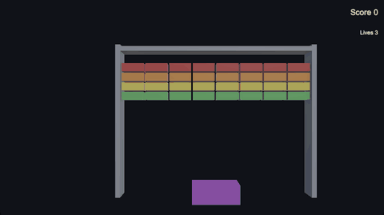
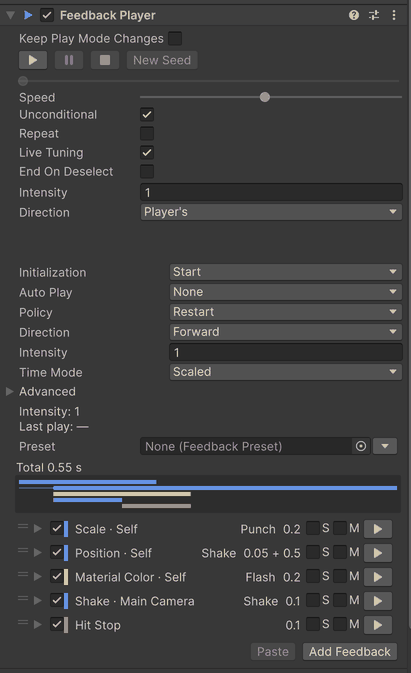

# xpTURN.Feedback

[English](README.md) | **한국어** | [日本語](README.ja-JP.md) | [简体中文](README.zh-CN.md)

> 이 문서는 영어 [README](README.md) 의 번역입니다. 내용이 다르면 영어판을 기준으로 합니다.

<!-- english: ba1e8cb6028f -->



Unity 6 을 위한 게임 필 피드백입니다. 타격 · 점프 · 버튼이 또렷이 느껴지게 하는 움직임 · 번쩍임 · 흔들림 · 멈춤을 만듭니다.
Feedback Player 는 항목의 목록을 가집니다. 대부분은 대상(값을 쓰는 곳)과 모션(그 값이 시간에 따라 움직이는 방식)의 짝이고,
나머지는 목록을 다듬는 동작과 단계입니다. PlayerLoop 의 스케줄러 하나가 모든 플레이어를 재생합니다. 흔들기 · 펀치 ·
번쩍임은 원래 값 위에 썼다가 되돌리고, 트윈과 설정은 끝난 자리에 값을 남깁니다. 한 번 데운 뒤에는 재생마다 할당하지 않으며,
같은 항목을 에디트 모드에서도 재생하므로 플레이 모드에 들어가지 않고 다듬을 수 있습니다. 장면에 미리 놓아 둘 것은 없습니다.

<!-- gen:snippet:readme-hit -->
```csharp
public class Enemy : MonoBehaviour
{
    [SerializeField] FeedbackPlayer onHit;
    [SerializeField] float maxHealth = 100f;

    public void TakeDamage(float damage)
        => onHit.Play(PlayArgs.Default.WithPosition(transform.position).WithIntensity(damage / maxHealth));
}
```
<!-- /gen:snippet:readme-hit -->

## 들어 있는 것

- **대상 × 모션** — 대상 <!-- gen:count:targets -->141<!-- /gen:count:targets --> 가지가 모션 <!-- gen:count:motions -->11<!-- /gen:count:motions --> 가지를 <!-- gen:count:combinations -->361<!-- /gen:count:combinations --> 가지 조합으로 받습니다.
- **추가 메뉴** — 검색 · 즐겨찾기 · 최근 항목을 갖춘 항목 <!-- gen:count:leaves -->377<!-- /gen:count:leaves --> 개.
- **에디트 모드 미리보기** — 플레이어의 ▶ 를 누르면 Scene 뷰와 Game 뷰에서 보이고, 멈추면 값이 돌아옵니다.
- **프리셋** — 오브젝트에 놓거나 플레이어에서 링크하는 프리셋 <!-- gen:count:presets -->21<!-- /gen:count:presets --> 개.
- **검증기와 디버거** — 클릭 한 번으로 고치는 `Window > xpTURN > Feedback Validator`, 지금 재생 중인 것을 보여 주는
  `Window > xpTURN > Feedback Debugger`.
- **샘플** — 첫 피드백부터 짧은 게임까지, 묶음 <!-- gen:count:bundles -->5<!-- /gen:count:bundles --> 개.



## 요구 사항

Unity 6000.0.85f2 이상. Unity 6000.3.28f1 과 6000.6.8f1 에서 시험했습니다(플레이어: macOS arm64 의 IL2CPP).

패키지 의존성은 없습니다. 아래의 선택 패키지나 내장 모듈은 각각 피드백 한 무리를 켭니다. 그 어셈블리는 해당 패키지가 표의
판 이상으로 설치됐을 때만 컴파일됩니다.

| 패키지 | 판 | 더하는 것 |
|---|---|---|
| Universal RP | 17.0.0 | 포스트 프로세싱 볼륨 · Light 2D |
| uGUI | 2.0.0 | UI · TextMesh Pro · 화면 플래시 · 페이드 · 떠오르는 글자 · `ProgressBar` |
| Cinemachine | 3.0.0 | 임펄스 · 노이즈 · 렌즈 · 카메라 활성화 |
| Input System | 1.0.0 | 게임패드 진동 |
| UniTask | 2.0.0 | `PlayAsUniTask` — 재생을 UniTask 로 기다리기 |
| Timeline | 1.8.0 | 타임라인에서 FeedbackPlayer 를 재생하는 트랙과 클립 · Timeline 창의 미리보기 |
| Animation module | 1.0.0 | Animator 의 파라미터 · 속도 · 레이어 · 상태 |
| Particle System module | 1.0.0 | 파티클 제어 · 방출 · 생성 |
| Physics module | 1.0.0 | Rigidbody 의 힘 · 속도 · 폭발 · Collider 켜고 끄기 |
| Physics 2D module | 1.0.0 | Rigidbody 2D 의 힘과 속도 |
| Video module | 1.0.0 | Video Player 제어 |

표의 판은 각 어셈블리가 컴파일되기 시작하는 판입니다. 이 패키지는 Universal RP 17.3.0 · uGUI 2.0.0 · Cinemachine 3.1.7 ·
Input System 1.20.1 · UniTask 2.5.11 · Timeline 1.8.13(Unity 6000.6 은 내장 Timeline 6.6.0)으로 시험했습니다.

패키지가 없으면 그 무리의 항목은 추가 메뉴에 흐리게 남고, 플레이어는 재생할 때 그 항목을 건너뜁니다(타임라인의 자리는
그대로입니다). 에디터와 개발 빌드에서는 그런 형식마다 세션에 한 번 경고가 나오고, 검증기는 FB-B07 을 알립니다. 선택
패키지를 지워도 저장된 항목은 남고, 다시 설치하면 다시 동작합니다.

## 설치

- Package Manager 에서 **+ > Add package from git URL…** 을 고르고
  `https://github.com/xpTURN/Feedback.git?path=/com.xpturn.feedback#v0.1.0` 을 넣습니다.
- 또는 **+ > Add package from disk…** 를 고르고 `com.xpturn.feedback` 폴더의 `package.json` 을 고릅니다.
- 또는 **+ > Add package from tarball…** 을 고르고 패키지의 `.tgz` 를 고릅니다.
- 또는 `Packages/manifest.json` 에 더합니다(상대 경로는 `Packages` 폴더에서 시작합니다):

```json
"com.xpturn.feedback": "file:../path/to/com.xpturn.feedback"
```

## 샘플

샘플은 Package Manager 에서 가져옵니다. xpTURN.Feedback 을 고르고 **Samples** 탭을 열어 묶음을 가져옵니다 — Basics,
Game Feel Labs, UI, Advanced, Showcase. 샘플에는 Input System(활성 입력 처리로) · uGUI · Universal RP 가 필요하고, 몇몇은 더
필요합니다(Cinemachine 3 · Timeline · Particle System · Physics · Physics 2D · Animation 모듈). 어느 샘플이 무엇을 쓰는지는
[시작하기](com.xpturn.feedback/Documentation~/GettingStarted.md#samples) 에 있습니다. 샘플의 TMP 글자를 위해 TextMesh Pro 의
Essential Resources 를 가져오십시오.

`SampleHub`(패키지 안 `SampleKit/Hub`)를 열고 플레이 모드에 들어가면 가져온 모든 샘플로 갈 수 있고, Esc 로 허브에
돌아옵니다. 플레이어용으로는 `Tools > xpTURN > Feedback > Samples > Build Samples` 가 허브와 샘플을 빌드 목록에, 샘플
카탈로그를 Preloaded Assets 에 넣고, `Tools > xpTURN > Feedback > Samples > Restore Build Settings` 가 둘을 되돌립니다.

## 문서

아래 문서는 영어로 쓰여 있습니다.

- [문서 홈](com.xpturn.feedback/Documentation~/index.md)
- [시작하기](com.xpturn.feedback/Documentation~/GettingStarted.md) — 첫 피드백을 한 걸음씩, 그다음 내 장면 · 에디터 도구 · 샘플
- [개념](com.xpturn.feedback/Documentation~/Concepts.md) — 대상과 모션 · 값이 쓰이는 방식 · 시간과 재생 · Unity Timeline
- [스크립트 API](com.xpturn.feedback/Documentation~/ScriptingAPI.md) — 코드에서 부르는 형식과, 직접 만드는 피드백(소리 ·
  미들웨어 이벤트 · 휴대폰 진동)의 바탕
- [피드백 레퍼런스](com.xpturn.feedback/Documentation~/Feedbacks.md) — 모든 피드백과 각각이 받는 모션
- [성능](com.xpturn.feedback/Documentation~/Performance.md) — 재생마다 할당 없음 · 재생마다 코루틴과의 비교 · 대상별 비용

## AI 코딩 어시스턴트

이 패키지에는 Claude Code 스킬 [`xpturn-feedback`](com.xpturn.feedback/Skills~/skills/xpturn-feedback/SKILL.md) 이 들어
있습니다. 스킬은 어시스턴트를 프로젝트에 든 패키지 사본 안의 문서로 보내므로, 읽는 내용이 설치한 판과 맞습니다. 또 파일로
다뤄도 안전한 변경 — 플레이어를 재생하거나 직접 만드는 피드백을 정의하는 C# 과, 프리셋 하나를 링크하는 새 플레이어 — 에만
머뭅니다. 항목과 그 값은
에디터에서 직접 정하십시오.

- **마켓플레이스에서** — Claude Code 에서 `/plugin marketplace add xpTURN/Feedback` 을 실행한 뒤
  `/plugin install xpturn-feedback@xpturn-feedback` 을 실행합니다. 이것은 저장소의 최신 판입니다. 아래 두 길은 프로젝트에
  든 사본을 쓰므로 설치한 판과 맞습니다.
- **프로젝트의 모든 세션에서** — 패키지의 `Skills~/skills/xpturn-feedback` 폴더를 프로젝트의 `.claude/skills` 폴더로
  복사합니다. 패키지를 올린 뒤에는 다시 복사하십시오.
- **한 세션에서만** — `claude --plugin-dir` 에 패키지의 `Skills~` 폴더를 주어 Claude Code 를 시작합니다.

git 이나 레지스트리로 설치하면 패키지 폴더는 `Library/PackageCache` 안에 `com.xpturn.feedback@` 과 해시로 된 이름으로
있습니다. 경우마다의 자리는 스킬의 [패키지 찾기](com.xpturn.feedback/Skills~/skills/xpturn-feedback/references/finding-the-package.md)
에 있습니다.

## 알아 둘 것

- **빌드와 링커** — 피드백 항목 안의 UnityEvent 호출(Unity Event · Random Unity Event · Float Event)은 Unity 의 링커에 보이지
  않습니다. 그래서 달리 부르는 곳이 없는 엔진 메서드는 Minimal 에서도 오류 없이 IL2CPP 빌드에서 지워집니다. 패키지의 빌드
  단계가 빌드 장면의 플레이어 · 그 장면이 쓰는 프리팹 · Resources 폴더의 프리팹 · 그 플레이어들이 링크한 프리셋에 대해 그
  메서드를 지킵니다. AssetBundles 나 Addressables 로만 플레이어에 닿는 콘텐츠는 읽지 않으므로, 그 엔진 메서드는
  `Assets/link.xml` 에 적으십시오(패키지 안의 `link.xml` 은 읽히지 않습니다). 스크립트만 다시 하는 빌드는 같은 빌드 대상의
  마지막 전체 빌드가 기록한 것을 다시 쓰고, 전체 빌드가 아직 없으면 경고를 남깁니다 — 먼저 전체 빌드를 하십시오.
- **AssetBundles** — 피드백 항목은 `[SerializeReference]` 데이터로 저장됩니다. 플레이어에 AssetBundle 안 항목의 형식이
  없으면 그 항목만이 아니라 에셋 전체가 null 로 로드됩니다. AssetBundle 은 그것을 로드하는 플레이어와 같은 패키지 판으로
  빌드하십시오. 직접 만든 피드백의 형식은 패키지의 빌드 단계가 통째로 지키므로, AssetBundle 에만 있는 것도 지워지지 않습니다.
- **Input System 1.20 과 시험 플레이어** — Input System 1.20(1.20.0 · 1.20.1)에서는 시험 어셈블리를 넣은 비개발 플레이어
  빌드가 Input System 패키지 자체를 컴파일하지 못합니다(그 시험 훅의 CS0117 오류). 시험 플레이어는 개발 빌드로 하거나,
  릴리스 빌드에서는 시험 어셈블리를 빼십시오.
- **이 패키지의 시험 돌리기**(`testables`) — PlayMode 실행 전에, 에디터에서든 플레이어에서든, 시험이 `Assets/` 아래 폴더
  셋(`FeedbackTestMaterial` · `FeedbackLinkerAssets` · `FeedbackTestAnimator`)을 만들고 패키지의 시험 장면 하나를 빌드 목록에
  더합니다. 둘 다 실행이 끝나면 지워집니다. 강제로 끝난 실행은 그것들을 남기고, 같은 시험의 다음 실행이 지웁니다.
