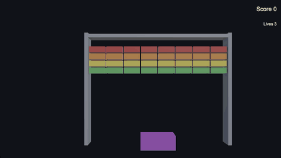
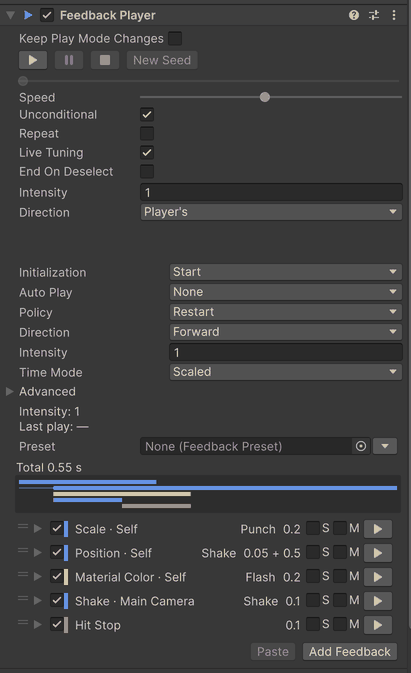

# xpTURN.Feedback

[English](README.md) | [한국어](README.ko-KR.md) | [日本語](README.ja-JP.md) | **简体中文**

> 本文档是英文 [README](README.md) 的翻译。如有出入，以英文版为准。

<!-- english: ba1e8cb6028f -->



面向 Unity 6 的游戏手感反馈：让命中、跳跃或按钮更有表现力的运动、闪光、震动与停顿。Feedback Player 持有一个条目列表；
大多数条目是一个目标（它写入的值）加一个运动（该值随时间如何变化），其余是塑造列表的动作和步骤。PlayerLoop 中的一个调度器
播放所有播放器。震动、冲击和闪光写在你的值之上并会还原，而补间和设置会把值留在结束的位置。预热之后，每次播放都不再分配内存；
同样的条目也能在编辑模式下播放，因此无需进入播放模式即可调整。无需事先在场景中放置任何东西。

<!-- gen:snippet:readme-hit -->
```csharp
public class Enemy : MonoBehaviour
{
    [SerializeField] FeedbackPlayer onHit;
    [SerializeField] float maxHealth = 100f;

    public void TakeDamage(float damage)
        => onHit.Play(PlayArgs.Default.WithPosition(transform.position).WithIntensity(damage / maxHealth));
}
```
<!-- /gen:snippet:readme-hit -->

## 包含的内容

- **目标 × 运动** — <!-- gen:count:targets -->141<!-- /gen:count:targets --> 个目标可使用 <!-- gen:count:motions -->11<!-- /gen:count:motions --> 种运动，共 <!-- gen:count:combinations -->361<!-- /gen:count:combinations --> 种组合。
- **添加菜单** — <!-- gen:count:leaves -->377<!-- /gen:count:leaves --> 个条目，支持搜索、收藏和最近使用。
- **编辑模式预览** — 在播放器上按 ▶ 即可在 Scene 视图和 Game 视图中查看；停止后值会恢复。
- **预设** — <!-- gen:count:presets -->21<!-- /gen:count:presets --> 个预设，可放到对象上或从播放器链接。
- **验证器和调试器** — 可一键修复的 `Window > xpTURN > Feedback Validator`，以及查看当前正在播放内容的
  `Window > xpTURN > Feedback Debugger`。
- **示例** — <!-- gen:count:bundles -->5<!-- /gen:count:bundles --> 个示例包，从第一个反馈到一个小游戏。



## 要求

Unity 6000.0.85f2 或更高版本。已在 Unity 6000.3.28f1 和 6000.6.8f1 上测试（播放器：macOS arm64 上的 IL2CPP）。

没有包依赖。下表中的每个可选包或内置模块都会启用一组反馈；其程序集仅在安装了不低于所示版本的该包时才会编译。

| 包 | 起始版本 | 新增内容 |
|---|---|---|
| Universal RP | 17.0.0 | 后期处理体积 · Light 2D |
| uGUI | 2.0.0 | UI · TextMesh Pro · 屏幕闪光、淡入淡出和浮动文字 · `ProgressBar` |
| Cinemachine | 3.0.0 | 脉冲 · 噪声 · 镜头 · 相机激活 |
| Input System | 1.0.0 | 手柄振动 |
| UniTask | 2.0.0 | `PlayAsUniTask` — 以 UniTask 等待一次播放 |
| Timeline | 1.8.0 | 从时间轴播放 FeedbackPlayer 的轨道和片段 · Timeline 窗口的预览 |
| Animation module | 1.0.0 | Animator 的参数、速度、层和状态 |
| Particle System module | 1.0.0 | 粒子控制、发射和生成 |
| Physics module | 1.0.0 | Rigidbody 的力、速度和爆炸 · Collider 开关 |
| Physics 2D module | 1.0.0 | Rigidbody 2D 的力和速度 |
| Video module | 1.0.0 | Video Player 控制 |

表中的版本是各程序集开始编译的版本。本包使用 Universal RP 17.3.0、uGUI 2.0.0、Cinemachine 3.1.7、Input System 1.20.1、
UniTask 2.5.11 和 Timeline 1.8.13（Unity 6000.6：其内置 Timeline 6.6.0）进行测试。

缺少对应的包时，该组的条目仍以灰色留在添加菜单中，播放器播放时会跳过它们（各自在时间轴上的位置保持不变）。在编辑器和开发
构建中，每种这样的类型每个会话警告一次，验证器会报告 FB-B07。移除可选包会保留已保存的条目；重新安装后它们会再次工作。

## 安装

- 在 Package Manager 中选择 **+ > Add package from git URL…**，然后输入
  `https://github.com/xpTURN/Feedback.git?path=/com.xpturn.feedback#v0.1.0`。
- 或选择 **+ > Add package from disk…**，然后选择 `com.xpturn.feedback` 文件夹中的 `package.json`。
- 或选择 **+ > Add package from tarball…**，然后选择本包的 `.tgz`。
- 或将其添加到 `Packages/manifest.json`（相对路径从 `Packages` 文件夹开始）：

```json
"com.xpturn.feedback": "file:../path/to/com.xpturn.feedback"
```

## 示例

从 Package Manager 导入示例：选择 xpTURN.Feedback，打开 **Samples** 标签页并导入一个示例包——Basics、Game Feel Labs、UI、
Advanced 或 Showcase。示例需要 Input System（作为当前的输入处理方式）、uGUI 和 Universal RP；少数示例还需要更多
（Cinemachine 3 · Timeline · Particle System、Physics、Physics 2D 或 Animation 模块），
[入门指南](com.xpturn.feedback/Documentation~/GettingStarted.md#samples) 列出了具体是哪些。请为示例中的 TMP 文本导入
TextMesh Pro 的 Essential Resources。

打开 `SampleHub`（位于包中的 `SampleKit/Hub`）并进入播放模式，即可前往所有已导入的示例；按 Esc 返回中心。构建播放器时，
`Tools > xpTURN > Feedback > Samples > Build Samples` 会把中心和示例放入构建列表、把示例目录放入 Preloaded Assets，
`Tools > xpTURN > Feedback > Samples > Restore Build Settings` 会将两者还原。

## 文档

以下文档以英文撰写。

- [文档首页](com.xpturn.feedback/Documentation~/index.md)
- [入门指南](com.xpturn.feedback/Documentation~/GettingStarted.md) — 一步步完成第一个反馈，然后是你自己的场景、编辑器工具和示例
- [概念](com.xpturn.feedback/Documentation~/Concepts.md) — 目标与运动、值的写入方式、时间与播放、Unity Timeline
- [脚本 API](com.xpturn.feedback/Documentation~/ScriptingAPI.md) — 从代码调用的类型，以及自定义反馈（声音、中间件事件、
  手机振动）的基础
- [反馈参考](com.xpturn.feedback/Documentation~/Feedbacks.md) — 所有反馈及各自可用的运动
- [性能](com.xpturn.feedback/Documentation~/Performance.md) — 每次播放零分配、与每次播放使用协程的对比、按目标的开销

## AI 编程助手

本包附带一个 Claude Code 技能 [`xpturn-feedback`](com.xpturn.feedback/Skills~/skills/xpturn-feedback/SKILL.md)。它会把助手
引导到项目中本包副本内的文档，因此读到的内容与你安装的版本一致；它也只做以文件形式进行同样安全的更改：播放播放器或定义自定义反馈的 C#，
以及链接某个预设的新播放器。条目及其数值仍由你在编辑器中设置。

- **从插件市场** — 在 Claude Code 中运行 `/plugin marketplace add xpTURN/Feedback`，然后运行
  `/plugin install xpturn-feedback@xpturn-feedback`。这是仓库中的最新版本；下面两种方式使用项目中的副本，因此与你安装的
  版本一致。
- **在项目的每个会话中** — 将本包的 `Skills~/skills/xpturn-feedback` 文件夹复制到项目的 `.claude/skills` 文件夹。更新本包后
  请重新复制。
- **仅用于一个会话** — 使用 `claude --plugin-dir` 并指定本包的 `Skills~` 文件夹来启动 Claude Code。

通过 git 或注册表安装时，本包的文件夹位于 `Library/PackageCache` 中，名称为 `com.xpturn.feedback@` 加一个哈希；技能的
[查找本包](com.xpturn.feedback/Skills~/skills/xpturn-feedback/references/finding-the-package.md) 列出了各种情况。

## 须知

- **构建与链接器** — 反馈条目中的 UnityEvent 调用（Unity Event、Random Unity Event、Float Event）对 Unity 的链接器不可见，
  因此没有其他调用者的引擎方法即使在 Minimal 级别也会被从 IL2CPP 构建中剥离，且不会报错。本包的构建步骤会为构建场景中的
  播放器、这些场景使用的预制体、Resources 文件夹中的预制体以及这些播放器链接的预设保留这些方法。仅通过 AssetBundles 或
  Addressables 到达播放器的内容不会被读取：请在 `Assets/link.xml` 中列出其引擎方法（包内的 `link.xml` 不会被读取）。仅脚本
  构建会复用同一构建目标上一次完整构建所记录的内容；若尚无完整构建，则会记录一条警告——请先进行一次完整构建。
- **AssetBundles** — 反馈条目以 `[SerializeReference]` 数据保存。如果播放器中没有 AssetBundle 内某个条目的类型，整个资源都会
  以 null 加载，而不只是那个条目。请使用与加载它们的播放器相同的包版本来构建 AssetBundles。自定义反馈的类型会被本包的构建
  步骤完整保留，因此仅存在于 AssetBundle 中的类型也不会被剥离。
- **Input System 1.20 与测试播放器** — 使用 Input System 1.20（1.20.0 和 1.20.1）时，包含测试程序集的非开发播放器构建无法
  编译 Input System 包本身（其测试钩子中的 CS0117 错误）。请对测试播放器使用开发构建，或在发布构建中排除测试程序集。
- **运行本包的测试**（`testables`）— 在 PlayMode 运行之前，无论在编辑器还是播放器中，测试都会在 `Assets/` 下创建三个文件夹
  （`FeedbackTestMaterial`、`FeedbackLinkerAssets`、`FeedbackTestAnimator`），并把包中的一个测试场景加入构建列表；运行结束时
  两者都会被移除。被强制终止的运行会留下它们，同一测试的下一次运行会将其移除。
