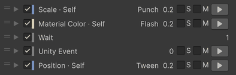
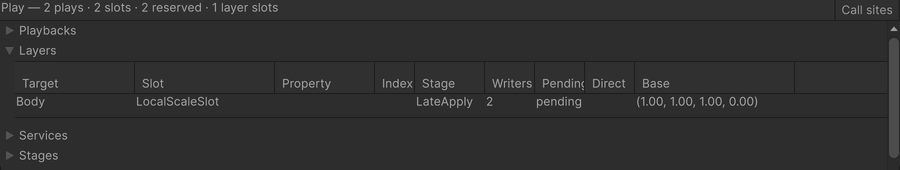
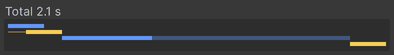
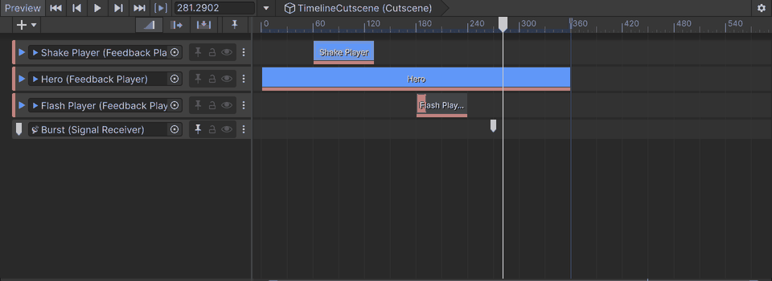

# Concepts

A Feedback Player holds a list of items. This page explains what an item is — a target with a motion — and what the
player does with it: how values are written on top of yours and put back, how time, direction and intensity shape a
play, and how channels and categories reach many players at once.

## Players and items

A [`FeedbackPlayer`](ScriptingAPI.md#feedbackplayer) plays a list of items — its own, or the list of the
[`FeedbackPreset`](ScriptingAPI.md#feedbackpreset) its **Preset** field links. Each `Play` starts one play of the whole
list. An item is one of three kinds:

- **Target items** drive a value of something in your scene — a transform's position, a material's color, a light's
  intensity — with one motion. They are <!-- gen:count:targets -->141<!-- /gen:count:targets --> of the Add menu's
  <!-- gen:count:feedbacks -->157<!-- /gen:count:feedbacks --> feedbacks.
- **Actions** do one thing when the play reaches them: call a UnityEvent, play another player, send a signal, stop time
  for a hit stop, send a Cinemachine impulse.
- **Flow items** shape the list itself: `Flow/Wait`, `Flow/Wait For Signal`, `Flow/Loop Start`, `Flow/Loop End` and
  `Flow/Hold`. The Add menu's Flow group also holds some actions.

The package plays no sound and drives no phone vibration. Add those — a sound, an FMOD or Wwise event, a platform's
haptics — as an action or an effect of your own; the player plays it like its own items. See
[Your own feedbacks](ScriptingAPI.md#your-own-feedbacks).

The player's settings apply to every play: when it prepares (**Initialization**), what a new play does to the plays that
run (**Policy**), the direction, the strength (**Intensity**) and the clock (**Time Mode**). Each item has its own
timing — **Rule**, **Delay**, **Duration** — and, under **Advanced**, its own conditions, randomness and the way it
takes the play's intensity.

A few names appear on both, with different meanings:

- **Intensity** — on the player, a number that every play's strength is multiplied by; on an item, whether the item
  takes the play's intensity (**Receive**) or plays at full strength (**Ignore**).
- **Chance**, **Cooldown**, **Randomize Duration** — on the player they act on the whole play; on an item, on that item
  only.
- **Direction** — on the player, the way the list plays; on an item, a condition (**Always**, **Forward Only**,
  **Reverse Only**) on which plays include it. An item's own **Play Direction** sets how it plays inside the list.

## Targets and motions

A target item reads a value from its target, plays a motion on it and writes the result back. The value is one of six
kinds — a number (Float), two, three or four numbers (Vector2, Vector3, Vector4), a Color or an on/off Bool — and the
[feedback reference](Feedbacks.md) gives each target's kind and the motions it takes. In the Add menu a target item is
`Group/Target/Motion` — `Transform/Scale/Punch` — and actions and flow items are `Group/Name`.

<!-- gen:count:targets -->141<!-- /gen:count:targets --> targets take
<!-- gen:count:motions -->11<!-- /gen:count:motions --> motions in
<!-- gen:count:combinations -->361<!-- /gen:count:combinations --> combinations:

<!-- gen:motions:all -->
| Motion | Kind | Writes | Targets | Description |
|---|---|---|---|---|
| `Set` | Instant | Persist | 41 | Writes its value at its moment in the list; with **Relative** it adds the value instead. |
| `Tween` | Timed | Persist | 106 | Goes to its value (**To**), from it (**From**), between two (**From To**) or by an amount (**By**) along an **Ease**, and stays at the end. |
| `Punch` | Timed | Offset | 38 | Kicks the value out by its **Amplitude** and lets it ring back to rest by the end. |
| `Shake` | Timed | Offset | 11 | Moves the value around with noise — **Smooth** or **Jitter** — fading out by the end; an endless item keeps shaking. |
| `Curve` | Timed | Offset | 19 | Adds a curve you draw, mapped from **Remap Zero** to **Remap One**. |
| `Flash` | Timed | Override | 46 | Goes to its **Target** and back — **Attack**, **Hold**, **Release** — over the item. |
| `Gradient` | Timed | Override · Persist (Mode: Persist) | 5 | Colors the value along a gradient over the item; with **Mode** Persist the last color stays. |
| `Oscillate` | Timed | Offset | 39 | Swings the value in a wave — Sine, Triangle, Square, Saw or Ping Pong — at its **Frequency**. |
| `Blink` | Timed | Override | 13 | Switches to its **Value** and back every **Period**, holding it for the **Duty** share. |
| `Wiggle` | Timed | Offset | 8 | Drifts the value with smooth noise, layered in **Octaves**. |
| `Spring` | Timed | Offset · Persist (Mode: Move To) | 35 | Springs the value with **Frequency** and **Damping**: **Bump** kicks it and it settles back, **Move To** springs it to its value, which stays. |
<!-- /gen:motions:all -->

**Kind** — a timed motion runs over the item's **Duration** (a Spring over the time it takes to settle); an instant one
happens at its moment in the list. **Writes** — an **Offset** adds to your value while it plays, an **Override**
replaces it for a while, and a **Persist** leaves its value written; a mode in brackets changes it. **Targets** — how
many targets take the motion. [How values are written](#how-values-are-written) shows how each is written.

An amplitude is in the target's own units: the same 1 is one unit of position, one degree of rotation, and twice the
size for a scale, whose offsets multiply. The Add menu starts each item with values that fit its target — 30° for a
rotation's Punch or Shake, for example.

A Shake's or Wiggle's amplitude is its peak at intensity 1: with the default falloff the motion does not go past it, and
on average it stays well below. Smooth noise — a Shake's default — has an RMS of about 0.49 of its amplitude, where a
sine of the same amplitude has 0.71, and a Wiggle with more than one octave sits lower still. A Smooth Shake crosses
zero as often as a sine of its **Frequency**.

## How values are written

Each property a feedback drives has one slot that composes the effects of every play on it over the value your game
gives it. A motion writes in one of three ways:

| Write | While it plays | After it |
|---|---|---|
| **Offset** | Added to your value — numbers add, a scale multiplies, a rotation turns — in the order the plays started. | Gone: your value shows again. |
| **Override** | Moves your value toward its own by its weight, after the offsets, in start order; at weight 1 it replaces it. On an on/off target, the latest that started wins. | Gone. |
| **Persist** | Written to the property itself, as if your code had written it. | Stays. A `Stop` with **Revert** writes the play's start value back; `Restore()` the value from before the first play. |

An item set to **Direct Write** has a slot of its own instead: it writes its value every frame it plays, without
composing with other plays, reading the property back or putting your value back.

Offsets and overrides are put back at the start of every frame and written again late in it (an on/off target is
written only when it has to change). Transforms, cameras, lights, material properties, render settings, PostFX, text and
UI values are written after `LateUpdate`, just before rendering; on/off switches, swaps (a sprite, a material, a parent,
a layer, a UI state), animators, particles, video, Cinemachine cameras, a TMP count and your own targets are written in
the Update stage, after your scripts' `Update`. Persist values are written when the play reaches them.

**What your scripts see**

- Your `FixedUpdate`, `Update` and `LateUpdate` see your own value on a target written after `LateUpdate` — without the
  offsets and overrides. A target written in the Update stage shows its value to that frame's `LateUpdate`.
- A Persist value is there from that frame's `LateUpdate` on.
- An instant item with no delay acts inside `Play()`, so the next line of your code sees it. Two wait: a
  `Time/Time Scale` Set reaches `Time.timeScale` in the Update stage, and a Set on an on/off target that a Blink holds
  shows when the Blink ends.

If something else writes a property while an effect plays — your script, say — the package keeps that write.
When it puts values back at the start of a frame it reads the property first: a value different from the one it wrote
becomes the new base instead of being overwritten. This holds for offsets and overrides, but not on a **Direct Write**
item's own slot; a `Stop` with **Revert** and
`Restore()` write a Persist's value back whatever is there.

A system that writes the same property later in the frame covers what was written before it. A Cinemachine brain, which
writes its camera in `LateUpdate`, covers a Persist value on that camera, while an offset written after `LateUpdate`
still shows — the validator's FB-H05 reports a lens feedback on such a camera.

Under a moving or shaking parent, a World-space position is converted through the parent as it is when the child's slot
writes. When the parent's effect is written first in the same stage the result is exact; otherwise the child is off by
the parent's shake in that frame — the order follows which slot started first. A World Persist ends at its world target;
after that its local value stays and the child follows its parent.

Material feedbacks write a property block (**Write Mode** Property Block, the default) or a copy of the material
(**Instance**). A Persist through a property block stays as a block; through an instance it goes when the last item
writing that renderer lets go, and the original material comes back where the copy still is — the
[Renderer notes](Feedbacks.md#renderer) say more.

PostFX feedbacks write the weight of an overlay volume of their own, not your volumes' values — `PostFX/Volume Weight`
works on your volume, and `PostFX/Volume Blend` blends your profile into its own. The
[PostFX notes](Feedbacks.md#postfx) say how overlapping weights add.

## Time

An item's **Rule** places it in the list: **With Previous** (the default) starts it with the item before it,
**After Previous** when that item ends, **After All** when everything before it has ended. **Delay** waits first, and
**Duration** is its length — a Set is instant, a Spring lasts until it settles, and an action has its own length. Under
**Advanced**, **Extra Runs** plays the item again that many more times with **Repeat Gap** between runs,
**Repeat Forever** makes the list endless unless the item is **Background**, and a **Background** item does not count
toward the list's length and is cut where the rest ends.

The player's **Start Delay** comes once before the list. **Duration Multiplier** scales every delay, duration and gap
but not the start delay. **Speed** plays everything faster or slower; at 0 the play holds in place without pausing.

**Time Mode** — **Scaled** follows `Time.timeScale`, **Unscaled** does not — applies to the items whose **Clock** is
**Player**; an item can pick **Scaled** or **Unscaled** for itself. Hit stops and time scale items always run on
unscaled time.

**Direction** is **Forward**, **Backward**, or **Toggle**, which turns at each play and starts Forward;
`PlayArgs.WithDirection` sets it for one play. A backward play runs the list from its end: a Set writes the value the
forward play before it started from, and a UnityEvent is not called unless its item plays only in reverse. An endless
list, one with a signal wait without a time limit or one that waits on another player cannot play backward: the backward
play is refused, with a warning.

A play can also turn around where it is: the Feedback UI Trigger's **Play Forward** and **Play Backward** entries and
`PlayFromEvent(bool)` do so when the player's latest play runs the other way. The same play goes on the other way from
its place, with no new `Played`; the instants it passes going back are undone as a backward play undoes them.

After a backward play, a From tween in the next forward play goes from its From value to the origin of the forward play
before it, and a To continues from wherever an interrupted backward play left it; after a backward play that reached its
end, a To starts from the value it finds. `Rebuild()` keeps the origin; a recompile in Play mode
loses it.

An item's own **Play Direction** — **Follow Player**, **Forward**, **Backward** or **Opposite** — plays it its own way
inside the list. It is not read for an item with a direction condition, one that waits on another player, or an endless
one; the validator's FB-C06 says so.

A **Cooldown** counts on unscaled time from each accepted play, whatever the **Time Mode** and while `Time.timeScale` is
0; a refused play does not start it, and `Rebuild()` clears it.

`Time/Hit Stop` sets the game's time scale for its **Freeze Duration** of real time, divided by the player's **Speed**.
It is skipped in a backward play, at **Speed** 0, and while the game already runs slower than its **Minimum Time Scale**
— so a second hit stop in the same frame is skipped when the first is slower than that minimum. Time feedbacks scale
from [`FeedbackTimeScale.BaseScale`](ScriptingAPI.md#feedbacktimescale) — set your pause and slow motion there.

## Playback

| Call | The plays | The values |
|---|---|---|
| `Play` | Starts a play of the whole list. **Policy** decides about the plays that run: **Restart** (the default) stops them with Hold, **Overlap** keeps the newest **Max Overlap**, **Ignore** refuses while one runs or is paused. | Instants with no delay act inside the call. |
| `Stop` | Ends the plays that run, with **Hold**, **Revert** or **Complete**. | Hold leaves Persist values where they are and drops offsets to your value; Revert writes the play's start values back; Complete writes the running items' ends. |
| `Pause` · `Resume` | Holds the plays, then lets them go on; paused plays still count for the **Policy**. | Offsets and overrides keep their last values. |
| `Seek` | Moves the plays, paused ones too, to a time on the list's own axis, **Start Delay** included. | Instants crossed run once; seeking back undoes them; a time at the end completes the play. |
| `Skip` | Ends the plays: the rest of their events run and they complete — one that cannot be sought stops with Complete instead. | As a finished play leaves them. |
| `Restore` | Stops the plays with Hold. | Writes each Persist value from before the first play back. |
| `Signal` | Ends the plays' signal waits. | — |

A `Play` is refused, returning `default`, for an argument out of range, a canceled token, the **Cooldown**, the distance
gate, **Ignore**, the player's **Chance**, a backward play of a list that cannot play backward, a `Play` inside the
player's own `Play`, or a player that is not ready (in edit mode, never awake or destroyed). Each accepted play has a
handle and ends once, for one [`PlaybackEnd`](ScriptingAPI.md#playbackend) reason. An endless list, a signal wait
without a time limit, a wait on another player, a wait a signal ended early and a play whose scaled and unscaled items
drifted apart under a hit stop cannot be sought.

Each target keeps room for the plays that can overlap on it — **Max Overlap** under **Overlap**, one otherwise; under
**Overlap** a play past it stops the oldest. When plays are replaced and started again many times within one frame, the
room grows, which allocates once, and the Editor and development builds warn.

**Apply Initial State** writes the first frame of the player's **Direction** when it prepares, so a From tween or a
Spring's Move To starts in place before any play. Only lasting timed items write it — To, From, From To, By, a Spring's
Move To and a Persist Gradient — with the player's own settings, so a play's arguments, a Toggle's second play or random
output can differ. `Rebuild()` writes it again only before the first play. Of two such items on one property, the
earlier wins in a forward play and the later in a backward one.

## Intensity, randomness and seeds

A play's intensity is its strength: the intensity of its `PlayArgs` (1 by default), through the player's
**Intensity Remap** curve when **Remap Intensity** is on, times the player's **Intensity**, times the distance gate's
falloff.

It scales an Offset's amplitude in proportion, an Override's weight up to 1, a Tween's change only with **By**, and a
Set or a Spring's Move To only when **Relative**; a Tween To, From or From To reaches its values whatever the intensity.
A category's scale then multiplies an Offset's output and an Override's weight; Persist writes do not take it. An item
whose **Intensity** is **Ignore** plays at 1, times its random output if it has one, and
**Use Intensity Range** skips an item when the play's intensity is outside its **Intensity Range**.

Randomness draws at each play: the player's and an item's **Chance**, **Randomize Duration** within **Duration Range**,
and an item's **Randomize Output** within **Output Range**.

A play given a seed with `PlayArgs.WithSeed` repeats its random parts — an item's chance, the durations, the output, a
Shake's noise — except the player's own **Chance**, which is drawn before the seed is read. The same seed gives the same
play within one version of the package. Items take their random parts by their place in the list, so an item inserted
before others changes theirs.

## Channels and signals

Channels reach players a script does not reference. `FeedbackChannels.Send` sends a command — Play, Stop, Pause, Resume,
Seek, Skip, Restore or Signal — to the [`FeedbackReceiver`](ScriptingAPI.md#feedbackreceiver) components on its channel,
each of which passes it to its player. Sent from a position, a command reaches a receiver with a **Range** only within
that distance of the receiver, and a Play without a position of its own plays there. Sending from inside a handler
works; outside Play mode nothing is sent.

Two things are called signals:

- The **Signal** command, and `FeedbackPlayer.Signal`, end the waits of `Flow/Wait For Signal` items in the plays that
  run — a wait whose **Time Limit** is 0 waits until then.
- A `Flow/Signal Broadcast` item, and `FeedbackSignals.Send`, carry a value to the signal receivers on a channel — a
  [`FeedbackSignalReceiver`](ScriptingAPI.md#feedbacksignalreceiver) or your own
  [`IFeedbackSignalReceiver`](ScriptingAPI.md#ifeedbacksignalreceiver).

A `Camera/Shake` sent to a channel moves the [`CameraShakeReceiver`](ScriptingAPI.md#camerashakereceiver) components on
it — at most the settings' **Shake Receivers Per Play** of them.

**Use Distance Gate** refuses a play farther than **Gate Distance** from its **Gate Reference** — the **Main Camera**,
an **Anchor**, the **Play Position**, or **Global**, the transform set in
[`FeedbackRange.Center`](ScriptingAPI.md#feedbackrange). The distance runs from the play's position, else the player's,
to the reference — with **Play Position**, from the player to the play's position, and a play without one passes.
**Use Gate Falloff** lowers the intensity along **Gate Falloff** as the distance grows. A reference that is missing lets
the play through.

## Categories and accessibility

Every effect counts in a category — Motion, Camera, Flash, PostFX, Time, Particles, UI, Haptics, or none — and
[`FeedbackCategories`](ScriptingAPI.md#feedbackcategories) turns categories off or scales them, for an options menu. The
[feedback reference](Feedbacks.md#feedback-reference) gives each feedback's own category and how an item's override and
flashes change it.

- A category that is off leaves its effects out of new plays — the item keeps its place — and drops the offsets and
  overrides that run to nothing; a Persist that runs goes on to its end.
- A category's scale multiplies offsets, override weights, blinks and camera shakes; Persist and Set values do not take
  it.
- Turning Time off skips new hit stops and time scale items. A hit stop already running ends as it was, and a running
  `Time/Time Scale` Flash drops to nothing.
- The flash limit lets a flash start while fewer than a set number started in the last second of real time — 3 by
  default, 0 lets none start. A started Blink counts each of its periods, a Seek back into a Flash counts it again, and
  an endless Blink uses the whole limit when it starts; **Speed** does not change the count.
- The switches start fresh in each play session, from the settings asset — apply your options when the game starts.

## Under the hood

The package runs in three stages it puts at the front of Unity's PlayerLoop: `FeedbackRevert` at the start of
`EarlyUpdate` puts values back, `FeedbackUpdate` at the start of `PreLateUpdate` — after your scripts' `Update` —
advances the plays and writes the Update-stage targets, and `FeedbackLateApply` at the start of `PostLateUpdate` — after
`LateUpdate` — writes the rest. The Profiler shows them by those names. If your code replaces the PlayerLoop after the
game starts, call [`FeedbackPlayerLoop.Reinstall`](ScriptingAPI.md#feedbackplayerloop).

There is no manager object to add. The services live with the play session; they make what they need — a pool's
container, the overlay canvases and volumes — when first used, and clean up when Play mode ends.

Once a player has prepared, a play allocates nothing: playing, pausing and stopping every target and motion is tested to
allocate no memory, and seeking, skipping and restoring on a list that mixes them. Allocations come when a player
prepares — a **Lazy** player at its first play —, at the first play after the main camera changes, when plays are
replaced many times within one frame, and at a UnityEvent's first call. [Performance](Performance.md) has the numbers.

## Unity Timeline

With the Timeline package (1.8 or later), a timeline plays your players. A **Feedback Track** is bound to one
`FeedbackPlayer`, and each clip on it is one play of that player — its list, its settings and its events. A clip's
**Timing** decides whose clock the play follows:

- **Driven** — the timeline's. Scrubbing, pausing, the director's speed and playing backward move the play, and the same
  time shows the same values: the play takes the clip's **Seed** and its list's nominal lengths, and the player's
  **Chance**, **Cooldown** and distance gate let it through. It leaves `Time.timeScale` alone, but a `Time/Hit Stop` in
  it still stops the game, and a director on the game's clock with it.
- **Triggered** — the player's. The clip starts a play when the timeline enters it, and the play runs on the player's
  clock and rules; it pauses while the director pauses.
- **Auto**, the default — Driven when the list can be scrubbed, Triggered when it cannot: an endless list or a
  `Flow/Wait For Signal` without a timeout.

When the timeline leaves a clip, its **End** — **Revert**, **Hold** or **Complete** — ends the play, as the player's
stops do; stopping the director reverts.

In Edit mode the Timeline window previews the track with the same runtime code: Driven clips follow scrubbing,
Triggered clips play while the window plays, and turning the preview off puts the scene back. The window's preview and
a player's Inspector **Preview** do not run together. In the window a clip's length is its player's list — a new clip
takes it and **Match Content** fits the clip to it.

A clip is one play with one **Intensity**: a Feedback track has no markers and a clip no intensity curve. To play a
player at a moment of the timeline, put a Signal on a Signal track and let a Signal Receiver call its
`PlayFromEvent`. That play comes in Play mode: the Timeline window's preview sends no signal while scrubbing, a
receiver's call is **Runtime Only** by default, and in Edit mode a player outside a preview plays nothing. Clips of
one player that overlap meet its **Policy**, as two calls of `Play` do. The
[Scripting API](ScriptingAPI.md#unity-timeline) has the track's and the clip's settings and the details of the preview.

## Edit-mode preview

The inspector's preview plays a player in Edit mode with the same runtime code, on a clock of its own. Unity's
AnimationMode records each property before its first write and puts it back when the preview ends; the package keeps its
own copy of what AnimationMode cannot hold — render settings, shader globals, a renderer's property block and others. A
preview cannot start while Timeline or the Animation window holds AnimationMode.

Some things differ from Play mode: UnityEvents are not called, a hit stop slows only the preview's clock, and rumble and
video do nothing — the [feedback reference](Feedbacks.md#feedback-reference) gives each feedback's preview. The bar
scrubs a play, pausing it; a play with simulated particles or animators cannot be scrubbed.
