# Getting Started

This page takes you from a sample scene to a feedback that plays on a jump and into your own scene, then through the
editor's tools — the inspector, the Add menu, the preview bar, presets, keeping changes made in Play mode, the debugger
and the validator — and over the samples.

## Your first feedback

Import the Basics bundle (see [Samples](#samples)) and open the **Getting Started** scene for the result:

<!-- gen:card:Samples~/Basics/GettingStarted/Complete/README.md#Try -->
Press Space to jump. The cube stretches on the jump and squashes on the landing — the harder the landing, the bigger. Then open 'Getting Started (Empty)' and build the same in five steps.
<!-- /gen:card:Samples~/Basics/GettingStarted/Complete/README.md#Try -->

Open **Getting Started (Empty)**. Then:

<!-- gen:card:Samples~/Basics/GettingStarted/Empty/README.md#Try -->
1. Select 'Body' (under 'Hero') and add a Feedback Player — or drag the Jump preset (Packages > xpTURN.Feedback > Presets) onto it.
2. In the player, click Add, type 'punch' and pick Transform/Scale/Punch — its target is the Body itself.
3. Press the player's ▶ to see it in edit mode; change the amplitude and play it again.
4. Select 'Hero' and drag the player into its Jump field — the script already calls Play() on a jump.
5. Save the scene, turn on the player's 'Keep Play Mode Changes', press Play and Space — tune it while playing; the change stays.
<!-- /gen:card:Samples~/Basics/GettingStarted/Empty/README.md#Try -->

**What you see on the way**

1. The player's inspector shows, from the top, a status line, the **Keep Play Mode Changes** toggle, the preview bar,
   the player's settings, its **Preset** field, the timeline strip and an empty list with **Paste** and **Add Feedback**
   under it. `Component > xpTURN > Feedback > Feedback Player` adds a player too. The Jump preset dropped on 'Body'
   gives the player a copy of the preset's `Transform/Scale/Punch` — go on with step 3.

   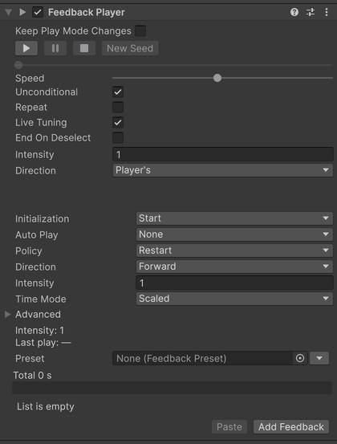

2. The button is **Add Feedback**, under the list. Typing 'punch' lists every Punch by its path; the item goes after the
   selected one, or at the end, with the object itself as its target.

   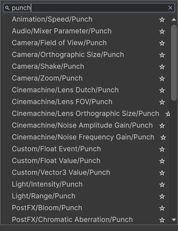

3. ▶ is the first button of the preview bar. The punch plays in the Scene and Game views and the time runs beside the
   scrub bar; at the end the inspector reads 'Ended — nothing plays.' and the scale is back. Change **Amplitude** while
   the preview runs and **Live Tuning** (on by default) plays it again; after it ended, press ▶ again.

   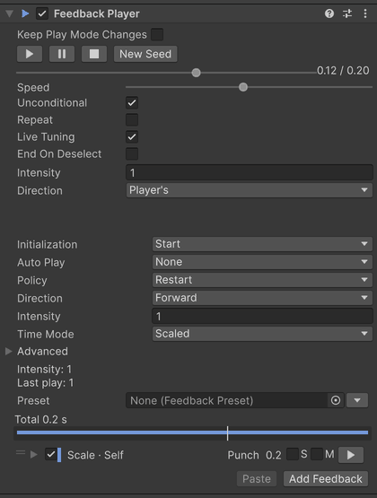

4. 'Hero' has a script with a **Jump** field; the player you drag into it plays on every jump.

   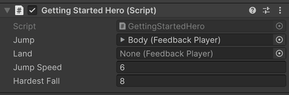

5. The toggle needs a scene saved to disk — in a new, unsaved scene it is off and its tooltip says why. Once it is on,
   **Turn off after play** appears, and in Play mode the status line reads 'Play mode changes of this player are kept
   when play stops.' A change to **Amplitude** in Play mode does not reach the next jump at once: the status line says
   the player changed after it prepared and shows **Rebuild**. Press it, and the next jump plays the new value; with
   **Auto Rebuild** on at the head of the timeline strip, the changes made after it rebuild by themselves. When play
   stops the change stays, and one Undo takes it back.

   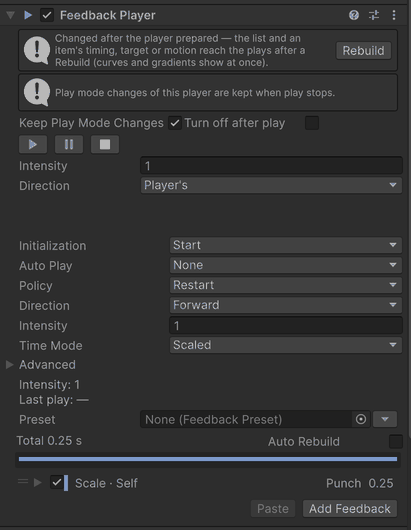

## In your own scene

**Drop a preset.** Drag a preset from Packages > xpTURN.Feedback > Presets in the Project window onto an object in the
Hierarchy: the object gets a player with the preset's items, or the items go at the end of its player's list — one Undo.
Dropped between rows or on empty space, a preset makes a new object named after it. The items are a copy; with
**Link on hierarchy drop (all presets)** on in a preset's inspector, one preset dropped on an object without a player,
or on empty space, is linked instead. A player that links a preset refuses a drop, with a warning.

**Play it from code.** Give your script a `FeedbackPlayer` field and call `FeedbackPlayer.Play` — with a position and an
intensity when the effect uses them:

<!-- gen:snippet:readme-hit -->
```csharp
public class Enemy : MonoBehaviour
{
    [SerializeField] FeedbackPlayer onHit;
    [SerializeField] float maxHealth = 100f;

    public void TakeDamage(float damage)
        => onHit.Play(PlayArgs.Default.WithPosition(transform.position).WithIntensity(damage / maxHealth));
}
```
<!-- /gen:snippet:readme-hit -->

[FeedbackPlayer](ScriptingAPI.md#feedbackplayer) has the other calls, the handles and the events.

**Shake the camera.** A `Camera/Shake` item's **Target** is the main camera by default, so it needs nothing else in the
scene; the preview notes that the shake shows in the Game view. To shake other cameras, send it to a channel and give
each one a `CameraShakeReceiver` — see [Cameras](ScriptingAPI.md#cameras).

**Cinemachine.** A camera that a Cinemachine brain drives needs
`Component > xpTURN > Feedback > Cinemachine Shake Extension` on each Cinemachine camera that can go live. Without it
the edit-mode preview shows no shake — the brain writes the camera over it — and the preview bar says so; the
validator's FB-R01 offers to add it. See [CinemachineShakeExtension](ScriptingAPI.md#cinemachineshakeextension).

## The editor

### The inspector

Select an object with a Feedback Player. From the top, its inspector shows:

- A status line for what needs your attention — a linked or missing preset, a missing type, and in Play mode an edit
  that waits for **Rebuild**.
- The **Keep Play Mode Changes** toggle and the preview bar, both below.
- The player's settings — **Initialization**, **Auto Play**, **Policy**, **Direction**, **Intensity** and **Time Mode**,
  with the rest under **Advanced**; [Players and items](Concepts.md#players-and-items) explains them.
- The intensity line: the player's intensity and that of its last play.
- The **Preset** field — see [Presets](#presets).
- The timeline strip: each item as a bar on the player's time — its delay thin, its runs in the item's category color —
  with the total time at its head. Drag a bar to move its delay and its right end to change its duration, in 0.01 s
  steps (hold Shift for none); one drag is one Undo.
- The item list, then a bar with the validation summary, **Paste** and **Add Feedback**.

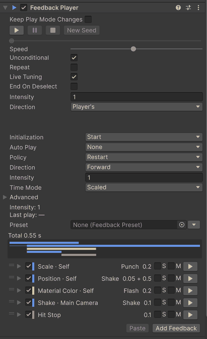

Each item's header shows its switch, its category color, its target, motion and time, a warning button when the
validator found something, and three buttons for the preview: **S** plays it with the other solo items, **M** leaves it
out and ▶ plays it alone. **S** and **M** are not saved; the three are not on flow items and hide in Play mode.
Right-click a header for Copy, Paste After, Duplicate, Delete, Move Up and Move Down, or drag it to reorder. Copied
items are deep copies; pasted ones go after the selected item, or at the end, and references into another scene are
cleared, with a warning.

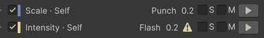

An item's timing — **Delay**, **Duration**, **Extra Runs**, **Repeat Gap**, **Repeat Forever** and **Background** — is
explained under [Time](Concepts.md#time). With several players selected, the inspector shows the settings, **Preset**
and **Keep Play Mode Changes** only: the item list is edited one player at a time.

### The Add menu

**Add Feedback** opens a menu with a search field. Empty, it shows **Favorites** (☆ marks one), **Recent** — the last
ten you added — and every category. Type to search: names come first, then paths and aliases ('hitstop' finds
`Time/Hit Stop`), and Enter adds the first. A dimmed entry needs an optional package that is not installed; it can still
be added. Drag an object or a component from the scene onto the list: the one feedback that takes it is added, or you
are offered the several that do. The
[Feedback reference](Feedbacks.md) lists every entry.

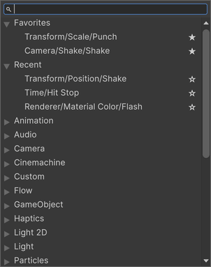

### The preview bar

The preview bar plays the player in edit mode, on the objects it moves, and puts every value back when the preview ends
— [Edit-mode preview](Concepts.md#edit-mode-preview) says what each feedback shows.

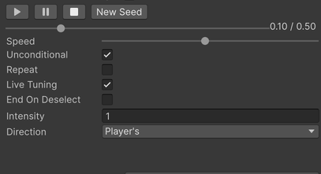

| Control | What it does |
|---|---|
| ▶ | Starts a preview, resumes a paused one, or plays it again from the start. |
| ❚❚ | Pauses and resumes. |
| ■ | Ends the preview and puts the values back. |
| **New Seed** | Plays again with a new random seed; a paused preview stays paused where it is. |
| The scrub bar | Pauses and seeks to that time, shown with the length beside it. A play that cannot seek says why. |
| **Speed** | The preview's clock rate, 0.1 to 2. |
| **Intensity** | The intensity of the preview's play. |
| **Direction** | **Player's** (the player's own **Direction**, the default), **Forward** or **Backward** — for the preview's play only. |
| **Unconditional** | On by default: the preview skips the chance, cooldown, distance gate and play limits of the player and its items, and plays at its nominal length. |
| **Repeat** | Off by default: plays again 0.2 s after each end, from the start values. |
| **Live Tuning** | On by default: an edit to the player or its linked preset plays the preview again 0.15 s later. |
| **End On Deselect** | Off by default: the preview ends when its object leaves the selection. |

The Scene view's **Feedback Preview** overlay names the previewed object — click it to select it — and has ■, and
**Signal** while a play waits for one. Editing a property the preview drives ends the preview and keeps your edit. In
Play mode ▶ ❚❚ ■ play, pause and stop the player itself, with **Intensity** and **Direction**.

### Presets

A preset is an item list in an asset; the package comes with <!-- gen:count:presets -->21<!-- /gen:count:presets --> of
them in Packages > xpTURN.Feedback > Presets. Make one with `Assets > Create > xpTURN > Feedback Preset`, or from a
player's items with **Save Items as Preset...** in the menu beside the **Preset** field — an item's target in the scene
becomes Self, Child or Parent where it can, and other references to scene objects are cleared, with a warning.
**Apply Items to Preset...** writes a player's items over a preset in one Undo.

Put a preset in a player's **Preset** field to link it: the player plays the preset's list and keeps its own settings.
Its list then shows read-only, with **Open Preset**, **Unlink** and **Unlink and Copy** below it; the status line sends
you to the preset's inspector, and an edit there reaches every player — in scenes, prefabs and variants — that links the
preset.

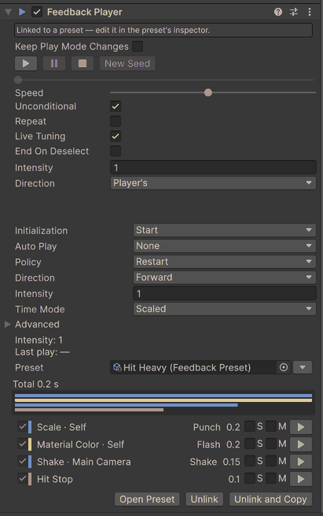

In edit mode, an edit to a preset plays a linked player's preview again (**Live Tuning**). In Play mode it reaches a
linked player that has prepared as an edit to its own list does: an item's **Intensity**, **Play Direction**, conditions
and randomness at its next play, curves and gradients at once, and the rest — the list, an item's timing, target and
motion values — at its next **Rebuild**, which the preset's inspector offers as **Rebuild Them**. The preset is an
asset, so a change made in Play mode stays. See [FeedbackPreset](ScriptingAPI.md#feedbackpreset).

### Keep Play Mode Changes

A player's changes made in Play mode are lost when play stops, as for any component. Turn on **Keep Play Mode Changes**
at the top of its inspector — before play or during it — and they are written back when play stops: every field of the
player (its settings only when it links a preset), in one Undo. What the feedbacks did to the objects they move is not
kept.

The mark lasts for this editor session and does not dirty the scene; **Turn off after play** clears every mark once the
changes are written. The toggle needs a scene saved to disk. On a prefab instance the kept changes are overrides.
References to objects made during play are cleared, with a warning, and a player made during play cannot be kept.

### The debugger

`Window > xpTURN > Feedback Debugger` shows what plays — in Play mode or in an edit-mode preview — and only reads. It
has five panels. **Playbacks** is a table of the plays: owner, number, position, the time since the play started,
state, intensity, seed, signal waits, missed signals, the play waiting on it, token and where it was called from.
Select a play for its items; double-click it to select its player. **Layers** is a table of the property slots —
target, type, stage and how many plays write them. **Services** and **Stages** are lines (the time of the three stages,
by their Profiler names `Feedback.Revert`, `Feedback.Update` and `Feedback.LateApply`). **Events** is a table of the
last 200 events with each end's reason — a play that ended without an event (an exception, a shutdown, a destroyed
player) has a row of its own — and **Clear**. Click a column's header to sort by it, right-click a header to hide or
show columns; the window keeps each table's sort and columns. A window narrower than the columns gets one horizontal
scroller at its bottom, which moves every table. With nothing to read it says 'No source — enter play mode or start a
preview.'

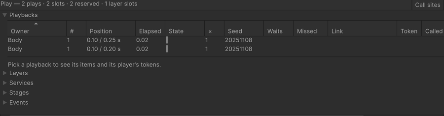

**Call sites** in the toolbar keeps where each play starts: the first call outside the package, or the package's own
call when the package started the play (an auto play, a Timeline clip, a flow item). Select the play to see its frames.
It costs about 0.2 ms a play and allocates while it is on, so it starts off.

The window refreshes ten times a second and builds its text in the editor, which allocates — close it, or keep it behind
another tab, while you measure allocations; a hidden window does not refresh. Events before a domain reload are dropped.

### The validator

The validator's findings show in the inspector: an item's header has a warning button with its most severe finding —
click it for the findings and their fix buttons — and the bar under the list counts the player's errors, warnings and
infos. `Tools > xpTURN > Feedback > Validate Open Scenes`, `Tools > xpTURN > Feedback > Validate Presets` and
`Tools > xpTURN > Feedback > Validate Prefabs` check the open scenes, the presets or the prefabs, write a one-line count
to the Console and open `Window > xpTURN > Feedback Validator` with the findings of that check, filtered by **Error**,
**Warning** and **Info**, each row with a button that selects its object; the window's **Validate Open Scenes** checks
the open scenes again. Opened from its menu, the window shows the last check's findings.
[Validation rules](Feedbacks.md#validation-rules) lists every rule.

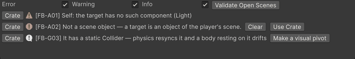

### Settings and channels

`Assets > Create > xpTURN > Feedback Settings` selects the project's settings — a `FeedbackSettings` asset in a
Resources folder — or makes `Assets/Resources/FeedbackSettings.asset` when there is none. The runtime reads only that
one; a settings asset elsewhere says so in its inspector. See [FeedbackSettings](ScriptingAPI.md#feedbacksettings).

`Assets > Create > xpTURN > Feedback Channel` makes a channel asset — a channel that senders and receivers share by
reference rather than by number. See [Channels and signals](Concepts.md#channels-and-signals) and
[FeedbackChannel](ScriptingAPI.md#feedbackchannel).

### While you edit

**Editing a moved object.** While a feedback plays on an object — in Play mode, paused or not — the object's inspector
shows your value with the effect on it. A field you edit there becomes the object's new value, the effect's share
included, and stays after the effect ends — the whole value, so editing one axis keeps the effect's share on the other
axes too. Tune effects in their items, and edit the object when nothing plays on it;
[How values are written](Concepts.md#how-values-are-written) says why.

**Recompiling in Play mode.** A recompile while playing ends every play with `PlaybackEnd.ContextShutdown`: offsets and
overrides go back, Persist values stay, gamepads stop rumbling, and the plays your code started do not start again,
nor is **Apply Initial State** written again. The players prepare
again — **Awake** and **Start** players when their objects are enabled again, **Lazy** ones at their next play — and
**Auto Play** players play again. The reload loses a `FeedbackPlayer.Restore` snapshot, a backward play's origin, the
receivers your code registered with `FeedbackSignals.Register` (register them in `OnEnable`) and a `MotionDriver` target
set as a value. The marks of **Keep Play Mode Changes** stay.

## Samples

Import a bundle from the Package Manager: select xpTURN.Feedback, open the **Samples** tab and import Basics, Game Feel
Labs, UI, Advanced or Showcase; it lands in `Assets/Samples/xpTURN.Feedback/<version>/<bundle>`. The samples need the
Input System as the active input handling, uGUI and Universal RP, and TextMesh Pro's Essential Resources for their text;
a sample's HUD says when the input handling or the Essential Resources are missing, and the hub dims a sample whose
packages are not installed. In Play mode, Tab turns a sample's feedback off and on (Before and After), `[` and `]` set
the intensity, `,` and `.` the time scale, H folds the HUD, and Esc returns to the hub.

Open `SampleHub` (in the package, `SampleKit/Hub`) and enter Play mode: every imported sample is a button, dimmed when
it needs a package you do not have. The two Getting Started samples and Unity Timeline Cutscene also offer **Open in
Editor**, which stops play and opens the sample's scene. **Also needs** lists what a sample needs beyond the Input
System, uGUI and Universal RP:

<!-- gen:samples:all -->
| Sample | Bundle | Also needs | Description |
|---|---|---|---|
| Getting Started | Basics | Physics module | Two players that stretch a cube on its jump and squash it on landing — the first feedback, finished. |
| Getting Started (Empty) | Basics | Physics module | The same scene without its players, to build that feedback in five steps. |
| Feedback Gallery | Basics | Particle System module · Physics module · Physics 2D module · Animation module | Every feedback with a typical motion, one button each; Compare plays every motion on one cube and Presets the package's presets. |
| Before / After | Game Feel Labs | Particle System module | One run and jump with and without feedback side by side — turn each layer (squash, dust, camera, trail) on and off. |
| Combat Hit Lab | Game Feel Labs | — | Light, heavy and critical hits: hit stop, flash, knockback, a damage number and rumble, scaled by intensity. |
| Camera Shake Lab | Game Feel Labs | — | Camera shakes on the main camera and through a channel, from presets and endless. |
| Cinemachine Shake Lab | Game Feel Labs | Cinemachine | The same shakes on a Cinemachine camera through its shake extension and on a plain camera, and the Cinemachine items. |
| Spring Playground | Game Feel Labs | — | Springs stepped from code beside a Motion Driver following the same target, with live frequency and damping. |
| PostFX Lab | Game Feel Labs | — | PostFX feedbacks on their own overlay volumes — a hit, slow motion and a low-health pulse that stack. |
| UI Juice | UI | — | uGUI feedbacks on the unscaled clock — hovers, purchases, progress bars and a reward popup that keep moving while the game is paused. |
| UI Trigger | UI | — | Feedback UI Trigger rows and UnityEvents with no script — hovers that turn back where they are, a toggle, a slider's intensity and a press whose second half waits for the release. |
| Timeline & Flow | Advanced | — | Flow items in one list — start rules, a stage loop and a signal wait — with pause, seek and backward play. |
| Channels & Range | Advanced | — | Sends to receivers on two channel assets, gated and faded by their distance from the source. |
| Stress & Zero-GC | Advanced | — | Up to thousands of players played and stopped, with the frame's allocation against a coroutine baseline. |
| Accessibility | Advanced | — | The category settings — screen shake, motion, flashes, hit stop and rumble — scaled or turned off while you hit. |
| Unity Timeline Cutscene | Advanced | Timeline | Feedback tracks on a timeline — a Driven shake and spring that follow a scrub, a Triggered flash and a Signal that plays a burst — previewed in the Timeline window in Edit mode. |
| Showcase | Showcase | Particle System module | A small brick breaker whose feedback grows with the combo, a boss fight, and a switch to play it plain. |
<!-- /gen:samples:all -->

The samples' kit — the HUD, the cards and the hub in `SampleKit` — is how the samples are shown, not part of the
package's API: build on what a sample shows, not on its kit. The samples read only their own input actions, so when your
project's actions bind the same keys both act; without the Input System or uGUI the hub opens with missing scripts.

For a player build, `Tools > xpTURN > Feedback > Samples > Build Samples` puts the hub first on the build list and the
scenes of the samples you can play after it, keeps your scenes after them and adds the sample catalogs to Preloaded
Assets; `Tools > xpTURN > Feedback > Samples > Restore Build Settings` puts both back. In the editor the hub
needs neither.

## Next

- [Concepts](Concepts.md) — what a player does with its items, how values are written, time and playback.
- [Scripting API](ScriptingAPI.md) — the types you call from code.
- [Feedback reference](Feedbacks.md) — every feedback, the motions it takes and what it needs.
