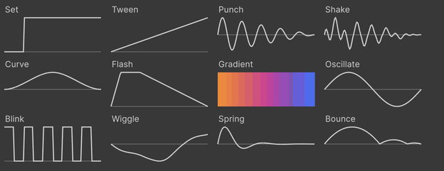
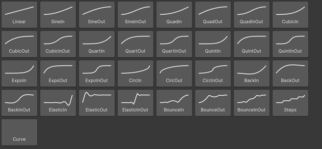

# Motion reference

A motion is the shape a target item plays on its value: a kick that rings back, a shake, a wave, a move to a value and
the others. Each target takes some of the motions — the [feedback reference](Feedbacks.md) lists them — and
[Concepts](Concepts.md#targets-and-motions) explains how a motion's value is written and how the intensity scales it.
This page gives each motion's shape and its parameters, then the eases. An item's **Graph** in the inspector draws its
motion with your settings — see [The graphs](GettingStarted.md#the-graphs).

Each motion's section ends with its parameters as the inspector shows them. **Values** is what a parameter takes and
**Default** what a motion made from code starts with. A value marked *per target* is set by the Add menu to fit the
target — 30° for a rotation's Punch, for example — and the Add menu sets a few other parameters for some targets too.

## Choosing a motion

| You want | Motion |
|---|---|
| A kick that rings back to rest — a hit, a press | [Punch](#punch) · [Spring](#spring) with **Bump** |
| A hop that settles — a landing, a pickup, an icon | [Bounce](#bounce) |
| A shake that fades out — an impact, an explosion | [Shake](#shake) |
| A steady swing — a hover, a glow, a breath | [Oscillate](#oscillate) |
| A slow, uneven drift — a float, a flicker, a hand-held camera | [Wiggle](#wiggle) |
| To move to a value and stay there | [Tween](#tween) · [Spring](#spring) with **Move To** · [Set](#set) at once |
| To show a value for a moment and go back — a hit color, a light | [Flash](#flash) |
| To switch on and off — a warning, a blink | [Blink](#blink) |
| A color that runs through a gradient | [Gradient](#gradient) |
| A shape you draw yourself | [Curve](#curve) |

## Set

Writes its **Value** at its moment in the list, and the value stays. It is instant: the item has no duration. With
**Relative** it adds the value, times the intensity, to the value it finds. On an on/off target the field is named
**Toggle**: a value other than 0 flips the state the play started from.

<!-- gen:params:Set -->
| Parameter | Values | Default | Description |
|---|---|---|---|
| Value | the target's value | per target | The value written, or added with **Relative**. |
| Relative | on · off | off | Adds the value, times the intensity, to the value found when the item starts. |
<!-- /gen:params:Set -->

## Tween

Moves the value along an **Ease** over the item and leaves it at the end. **Mode** picks the two ends: **To** goes from
the value it finds to **To**, **From** comes from **From** back to the value it finds, **From To** goes from **From** to
**To**, and **By** adds **To**, times the intensity, to the value it finds.

<!-- gen:params:Tween -->
| Parameter | Values | Default | Description |
|---|---|---|---|
| Mode | To · From · From To · By | To | The two values the tween goes between. |
| From | the target's value | per target | The start for **From** and **From To**. |
| To | the target's value | per target | The end for **To** and **From To**; the amount for **By**. |
| Ease | an ease | Linear | How the value moves between the two — see [Eases](#eases). |
| Loops | ≥ 1 | 1 | How many times it runs within the item's duration. |
| Yoyo | on · off | off | Every second run goes back the other way, so an even count ends where it started. |
<!-- /gen:params:Tween -->

## Punch

Kicks the value out by its **Amplitude** and lets it ring back to rest by the end of the item: it swings **Vibrato**
times and dies down as it goes. It adds to your value, so the value ends where it started.

<!-- gen:params:Punch -->
| Parameter | Values | Default | Description |
|---|---|---|---|
| Amplitude | the target's value | per target | The kick's size at intensity 1, in the target's units. |
| Vibrato | ≥ 0 | 5 | The swings over the item's duration. |
| Decay | ≥ 0.01 | 1 | How fast the swings die down — higher dies sooner. |
<!-- /gen:params:Punch -->

## Shake

Moves the value around with noise — each component on its own — and fades it out over the item along **Falloff**.
**Smooth** noise drifts and crosses zero as often as a sine of its **Frequency**; **Jitter** jumps to a new value
**Frequency** times a second. **Fade In** grows it from nothing over that share of the item, along **Fade Ease**; the
falloff still runs over the whole item, so a long fade-in peaks below the amplitude. An endless item, or a
[Motion Driver](ScriptingAPI.md#motiondriver)'s Loop, keeps shaking at full size — Fade In does nothing there.

<!-- gen:params:Shake -->
| Parameter | Values | Default | Description |
|---|---|---|---|
| Amplitude | the target's value | per target | The peak at intensity 1, in the target's units. |
| Frequency | ≥ 0 | 10 | How often the noise changes, per second. |
| Noise | Smooth · Jitter | Smooth | Smooth drifts; Jitter jumps from value to value. |
| Falloff | an ease | Linear | The ease the shake fades out along, from full size at the start to none at the end — see [Eases](#eases). |
| Fade In | 0 – 1 | 0 | The share of the duration it takes to grow from nothing. |
| Fade Ease | an ease | Linear | The ease Fade In grows along — see [Eases](#eases). |
<!-- /gen:params:Shake -->

## Curve

Adds a curve you draw, over the item: the curve's 0 adds **Remap Zero** and its 1 adds **Remap One**. The default curve
rises and falls back, so the value ends where it started.

<!-- gen:params:Curve -->
| Parameter | Values | Default | Description |
|---|---|---|---|
| Curve | a curve | 0 → 1 → 0 | Its time runs from 0 to 1 over the item's duration. |
| Remap Zero | the target's value | per target | What the curve's 0 adds. |
| Remap One | the target's value | per target | What the curve's 1 adds. |
<!-- /gen:params:Curve -->

## Flash

Goes to its **Target** and back over the item: it rises for **Attack**, stays for **Hold** and falls for **Release**,
each a share of the item's duration. It replaces your value while it shows, and the intensity sets how far it goes — all
the way at 1.

<!-- gen:params:Flash -->
| Parameter | Values | Default | Description |
|---|---|---|---|
| Target | the target's value | per target | The value it goes to. |
| Attack | ≥ 0 | 0.1 | The share of the duration it takes to rise. |
| Hold | ≥ 0 | 0.2 | The share it stays at the target. |
| Release | ≥ 0 | 0.7 | The share it takes to fall back; shares that add up to more than 1 are scaled down. |
| Ease | an ease | Linear | The rise's ease; the fall runs it backwards — see [Eases](#eases). |
<!-- /gen:params:Flash -->

## Gradient

Colors the value along its **Gradient** over the item — a color target's. With **Mode** Override it replaces your color
while it plays; with Persist the gradient's last color stays.

<!-- gen:params:Gradient -->
| Parameter | Values | Default | Description |
|---|---|---|---|
| Gradient | a gradient | white | Its time runs from 0 to 1 over the item's duration. |
| Mode | Override · Persist | Override | Override gives your color back at the end; Persist keeps the last color. |
<!-- /gen:params:Gradient -->

## Oscillate

Swings the value in a wave at its **Frequency**, from **Phase**. Ping Pong goes between 0 and the **Amplitude**; the
other waves go between minus and plus it. Without a fade, when a finite item ends the value goes straight back from
where the wave is — a Sine from phase 0 that ends on a whole number of cycles stops smoothly. **Fade In** grows the wave
from nothing and **Fade Out** shrinks it to nothing by the end, each over its share of the item, along **Fade Ease**. An
endless item, or a Motion Driver's Loop, keeps swinging — the fades do nothing there. With **Per Axis** each component
runs its own wave, shifted by **Axis Phase** and sped up by **Axis Frequency**: a position can circle, or trace an
ellipse or a figure eight.

<!-- gen:params:Oscillate -->
| Parameter | Values | Default | Description |
|---|---|---|---|
| Amplitude | the target's value | per target | The wave's peak at intensity 1, in the target's units. |
| Frequency | ≥ 0 | 1 | Cycles per second. |
| Waveform | Sine · Triangle · Square · Saw · Ping Pong | Sine | The wave's shape. |
| Phase | 0 – 1 | 0 | Where in its cycle the wave starts, as a share of a cycle. |
| Per Axis | on · off | off | Gives each component its own wave — shown on targets of two or more components. |
| Axis Phase | a number per component | 0 each | Per Axis: added to **Phase**, in cycles — a Sine with 0.25 on Y circles. |
| Axis Frequency | ≥ 0 per component | 1 each | Per Axis: multiplies **Frequency** — a Sine with 1 on X and 2 on Y traces a figure eight. |
| Fade In | 0 – 1 | 0 | The share of the duration it takes to grow from nothing. |
| Fade Out | 0 – 1 | 0 | The share it takes to shrink to nothing by the end; shares that add up to more than 1 are scaled down. |
| Fade Ease | an ease | Linear | The ease Fade In grows along; Fade Out runs it backwards — see [Eases](#eases). |
<!-- /gen:params:Oscillate -->

## Blink

Switches to its **Value** and back every **Period**, on for the **Duty** share of each period. It replaces your value
while it is on. On an on/off target it switches the state.

<!-- gen:params:Blink -->
| Parameter | Values | Default | Description |
|---|---|---|---|
| Value | the target's value | per target | The value it switches to. |
| Period | ≥ 0.0001 | 0.2 | Seconds from one switch-on to the next. |
| Duty | 0 – 1 | 0.5 | The share of each period it is on. |
| Jitter | 0 – 1 | 0 | How much each period's on time varies, as a share of it — 0 keeps a steady beat. |
| Start On | on · off | on | On at the start of each period; off, it is on at each period's end instead. |
<!-- /gen:params:Blink -->

## Wiggle

Drifts the value with smooth noise — each component on its own — in **Octaves**: each octave adds a wobble twice as fast
and half as big. **Fade In** grows it from nothing and **Fade Out** shrinks it to nothing by the end, along
**Fade Ease**; without them a finite item's value goes straight back when it ends. An endless item, or a Motion
Driver's Loop, keeps drifting — the fades do nothing there.

<!-- gen:params:Wiggle -->
| Parameter | Values | Default | Description |
|---|---|---|---|
| Amplitude | the target's value | per target | The peak at intensity 1; on average it stays well below it. |
| Frequency | ≥ 0 | 1 | How fast the main drift moves, per second. |
| Octaves | 1 – 3 | 2 | The layers of noise. |
| Fade In | 0 – 1 | 0 | The share of the duration it takes to grow from nothing. |
| Fade Out | 0 – 1 | 0 | The share it takes to shrink to nothing by the end; shares that add up to more than 1 are scaled down. |
| Fade Ease | an ease | Linear | The ease Fade In grows along; Fade Out runs it backwards — see [Eases](#eases). |
<!-- /gen:params:Wiggle -->

## Spring

Springs the value with **Frequency** and **Damping**. **Bump** kicks it, with **Value** as the kick's speed, and it
settles back to where it was; **Move To** springs it to **Value**, which stays. The item runs for as long as the spring
takes to settle — the motion's own length, not the item's **Duration**.

<!-- gen:params:Spring -->
| Parameter | Values | Default | Description |
|---|---|---|---|
| Mode | Bump · Move To | Bump | A kick that settles back, or a move that stays. |
| Value | the target's value | per target | Bump: the kick's speed at intensity 1, in the target's units per second. Move To: the value it goes to. |
| Relative | on · off | off | Move To: **Value**, times the intensity, is added to the value found when the item starts. |
| Frequency | ≥ 0.001 | 6 | How fast it swings, per second. |
| Damping | ≥ 0.01 | 0.4 | Below 1 it goes past and rings; at 1 and above it settles without passing. |
| Settle | 0.000001 – 0.99 | 0.001 | How close counts as settled, as a share of the distance — it sets the motion's length. |
<!-- /gen:params:Spring -->

## Bounce

Hops the value up from where it is and lets it fall back, **Count** times, like a ball settling: the first hop peaks at
**Amplitude**, and each hop after it lasts **Restitution** times as long as the one before and rises **Restitution**²
as high. The hops share the item's duration. It starts and ends at rest and goes one way only — a negative amplitude
dips instead. An endless item stays at rest, and a Motion Driver's Loop does not take it. For a value that drops onto
its end and bounces there, use a Tween with **Bounce Out**.

<!-- gen:params:Bounce -->
| Parameter | Values | Default | Description |
|---|---|---|---|
| Amplitude | the target's value | per target | The first hop's peak at intensity 1, in the target's units. |
| Count | 1 – 10 | 3 | The hops over the item's duration. |
| Restitution | 0.05 – 1 | 0.5 | Each hop lasts this times the one before and rises its square as high; at a low one the later hops are too small to see. |
<!-- /gen:params:Bounce -->

## Eases

An ease shapes how a value goes from 0 to 1. A Tween moves along its **Ease**, a Flash rises along its ease and falls
along it backwards, a Shake fades out along its **Falloff**, and an Oscillate, Wiggle or Shake fades in along its
**Fade Ease** — an Oscillate or Wiggle fades out along it backwards. Each family comes in three: In starts slowly, Out
ends slowly, and In Out does both. **Steps** does not glide: it jumps in even steps, the last at the end. Pick an ease
in the inspector from its grid.

<!-- gen:eases:all -->
| Ease | Types | Parameters | Description |
|---|---|---|---|
| Linear | `Linear` | — | An even pace. |
| Sine | `SineIn` · `SineOut` · `SineInOut` | — | The gentlest curve. |
| Quad | `QuadIn` · `QuadOut` · `QuadInOut` | — | A little stronger than Sine. |
| Cubic | `CubicIn` · `CubicOut` · `CubicInOut` | — | Stronger again. |
| Quart | `QuartIn` · `QuartOut` · `QuartInOut` | — | Stronger again. |
| Quint | `QuintIn` · `QuintOut` · `QuintInOut` | — | The strongest of the power curves. |
| Expo | `ExpoIn` · `ExpoOut` · `ExpoInOut` | — | Almost still at one end, fast at the other. |
| Circ | `CircIn` · `CircOut` · `CircInOut` | — | A quarter circle: a sharp turn at one end. |
| Back | `BackIn` · `BackOut` · `BackInOut` | Overshoot 1.70158 | In pulls back before it goes; Out goes past the end and comes back. **Overshoot** sets how far. |
| Elastic | `ElasticIn` · `ElasticOut` · `ElasticInOut` | Amplitude 1 · Period 0.3 | Rings like a spring about the end. **Amplitude** sets its size and **Period** its speed. |
| Bounce | `BounceIn` · `BounceOut` · `BounceInOut` | — | Bounces like a dropped ball — at the end for Out, at the start for In. |
| Custom | `Custom` | Curve | Follows a curve you draw; the grid names it **Curve**. |
| Steps | `Steps` | Steps 4 | Jumps in even steps and holds between them — **Steps** sets how many; the last jump lands at the end. |
<!-- /gen:eases:all -->
