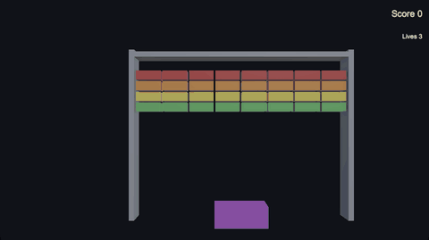
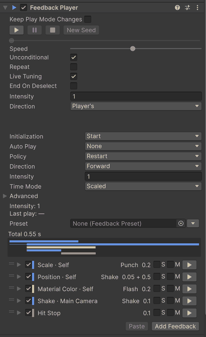

# xpTURN.Feedback



Game feel feedbacks for Unity 6: the motions, flashes, shakes and pauses that make a hit, a jump or a button read. A
Feedback Player holds a list of items; most are a target (the value it writes) with a motion (how that value moves over
time), and the rest are actions and steps that shape the list. One scheduler in the PlayerLoop plays every player.
Shakes, punches and flashes write on top of your values and put them back, while tweens and sets leave a value where
they end. It allocates nothing per play once it is warmed up, and plays the same items in edit mode so you can tune
them without entering Play mode. Nothing has to be placed in the scene first.

<!-- gen:snippet:readme-hit -->
```csharp
public class Enemy : MonoBehaviour
{
    [SerializeField] FeedbackPlayer onHit;
    [SerializeField] float maxHealth = 100f;

    public void TakeDamage(float damage)
        => onHit.Play(PlayArgs.Default.WithPosition(transform.position).WithIntensity(damage / maxHealth));
}
```
<!-- /gen:snippet:readme-hit -->

## What you get

- **Targets × motions** — <!-- gen:count:targets -->141<!-- /gen:count:targets --> targets take <!-- gen:count:motions -->11<!-- /gen:count:motions --> motions in <!-- gen:count:combinations -->361<!-- /gen:count:combinations --> combinations.
- **The Add menu** — <!-- gen:count:leaves -->377<!-- /gen:count:leaves --> entries with search, favorites and recent items.
- **Edit-mode preview** — press ▶ on a player to see it in the Scene and Game views; the values come back when it stops.
- **Presets** — <!-- gen:count:presets -->21<!-- /gen:count:presets --> presets to drop on an object or link from a player.
- **A validator and a debugger** — `Window > xpTURN > Feedback Validator` with one-click fixes, and
  `Window > xpTURN > Feedback Debugger` for what is playing now.
- **Samples** — <!-- gen:count:bundles -->5<!-- /gen:count:bundles --> bundles, from a first feedback to a short game.



## Requirements

Unity 6000.0.85f2 or later. Tested with Unity 6000.3.28f1 and 6000.6.8f1 (players: IL2CPP on macOS arm64).

No package dependencies. Each optional package or built-in module below turns on a group of feedbacks; its assembly
compiles only when that package is installed at the version shown or later.

| Package | From | Adds |
|---|---|---|
| Universal RP | 17.0.0 | post-processing volumes · Light 2D |
| uGUI | 2.0.0 | UI · TextMesh Pro · screen flash, fade and floating text · `ProgressBar` · `FeedbackUITrigger` |
| Cinemachine | 3.0.0 | impulses · noise · lens · camera activation |
| Input System | 1.0.0 | gamepad rumble |
| UniTask | 2.0.0 | `PlayAsUniTask` — await a play as a UniTask |
| Timeline | 1.8.0 | a track and clips that play a FeedbackPlayer from a timeline · the Timeline window's preview |
| Animation module | 1.0.0 | Animator parameters, speed, layers and states |
| Particle System module | 1.0.0 | particle control, emission and spawning |
| Physics module | 1.0.0 | Rigidbody forces, velocities and explosions · Collider switches |
| Physics 2D module | 1.0.0 | Rigidbody 2D forces and velocities |
| Video module | 1.0.0 | Video Player control |

The versions shown are where each assembly starts to compile. The package is tested with Universal RP 17.3.0, uGUI
2.0.0, Cinemachine 3.1.7, Input System 1.20.1, UniTask 2.5.11 and Timeline 1.8.13 (Unity 6000.6: its built-in Timeline
6.6.0).

Without its package, a group's items stay in the Add menu, dimmed, and a player skips them when it plays (each keeps its
place in the timeline). In the Editor and in development builds, a warning names each such type once per session, and
the validator reports FB-B07. Removing an optional package keeps the saved items; they work again when it is
reinstalled.

## Install

- In the Package Manager, choose **+ > Add package from git URL…** and enter
  `https://github.com/xpTURN/Feedback.git?path=/com.xpturn.feedback#v0.1.0`.
- Or choose **+ > Add package from disk…** and select `package.json` in the `com.xpturn.feedback` folder.
- Or choose **+ > Add package from tarball…** and select the package's `.tgz`.
- Or add it to `Packages/manifest.json` (a relative path starts from the `Packages` folder):

```json
"com.xpturn.feedback": "file:../path/to/com.xpturn.feedback"
```

## Samples

Import samples from the Package Manager: select xpTURN.Feedback, open the **Samples** tab and import a bundle — Basics,
Game Feel Labs, UI, Advanced or Showcase. The samples need the Input System (as the active input handling), uGUI and
Universal RP; a few need more (Cinemachine 3 · Timeline · the Particle System, Physics, Physics 2D or Animation
modules), and [Getting Started](Documentation~/GettingStarted.md#samples) lists which. Import TextMesh Pro's Essential
Resources for the samples' TMP text.

Open `SampleHub` (in the package, `SampleKit/Hub`) and enter Play mode to reach every imported sample; Esc returns to
the hub. For a player, `Tools > xpTURN > Feedback > Samples > Build Samples` puts the hub and the samples on the build
list and the sample catalogs in Preloaded Assets, and `Tools > xpTURN > Feedback > Samples > Restore Build Settings`
puts both back.

## Documentation

- [Documentation home](Documentation~/index.md)
- [Getting Started](Documentation~/GettingStarted.md) — your first feedback step by step, then your own scene, the
  editor's tools and the samples
- [Concepts](Documentation~/Concepts.md) — targets and motions, how values are written, time and playback, Unity
  Timeline
- [Scripting API](Documentation~/ScriptingAPI.md) — the types you call from code, and the bases for feedbacks of your
  own (a sound, a middleware event, a phone's vibration)
- [Feedback reference](Documentation~/Feedbacks.md) — every feedback and the motions it takes
- [Performance](Documentation~/Performance.md) — no allocation per play, against a coroutine per play, the cost by
  target

## AI coding assistants

The package carries a Claude Code skill, [`xpturn-feedback`](Skills~/skills/xpturn-feedback/SKILL.md). It sends the
assistant to the documentation inside your project's copy of the package, so what it reads matches the version you
installed, and it keeps to the changes that are safe in files: C# that plays a player or makes a feedback of your own,
and a new player that links one of the presets. Items and their values stay yours to set in the editor.

- **From the marketplace** — in Claude Code, run `/plugin marketplace add xpTURN/Feedback` and then
  `/plugin install xpturn-feedback@xpturn-feedback`. This is the repository's latest version; the two ways below use the
  copy in your project, which matches the version you installed.
- **In every session of a project** — copy the package's `Skills~/skills/xpturn-feedback` folder into the project's
  `.claude/skills` folder. Copy it again after you update the package.
- **For one session** — start Claude Code with `claude --plugin-dir` and the package's `Skills~` folder.

For a git or registry install the package's folder is in `Library/PackageCache`, named `com.xpturn.feedback@` and a
hash; the skill's [Finding the package](Skills~/skills/xpturn-feedback/references/finding-the-package.md) lists each
case.

## Good to know

- **Builds and the linker** — UnityEvent calls inside feedback items (Unity Event, Random Unity Event, Float Event) are
  not visible to Unity's linker, so an engine method that nothing else calls is stripped from IL2CPP builds, even at
  Minimal, with no error. The package's build step keeps those methods for the players in the build's scenes, the
  prefabs those scenes use, the prefabs in Resources folders and the presets those players link. Content that reaches
  the player only through AssetBundles or Addressables is not read: list its engine methods in `Assets/link.xml` (a
  `link.xml` inside a package is not read). A scripts-only build reuses what the last full build for the same build
  target recorded; with no full build yet it logs a warning — make a full build first.
- **AssetBundles** — feedback items are saved as `[SerializeReference]` data. If a player does not have the type of an
  item in an AssetBundle, the whole asset loads as null, not just that item. Build AssetBundles with the same package
  version as the players that load them. The types of your own feedbacks are kept whole by the package's build step, so
  one that only an AssetBundle holds is not stripped.
- **Input System 1.20 and test players** — with Input System 1.20 (1.20.0 and 1.20.1), a non-development player build
  that includes test assemblies fails to compile the Input System package itself (CS0117 errors in its test hooks).
  Use a development build for test players, or leave the test assemblies out of release builds.
- **Running this package's tests** (`testables`) — before a PlayMode run, in the Editor or in a player, the tests create
  three folders under `Assets/` (`FeedbackTestMaterial`, `FeedbackLinkerAssets`, `FeedbackTestAnimator`) and add a
  test scene from the package to the build list; both are removed when the run ends. A run that is killed leaves them;
  the next run of the same tests removes them.
